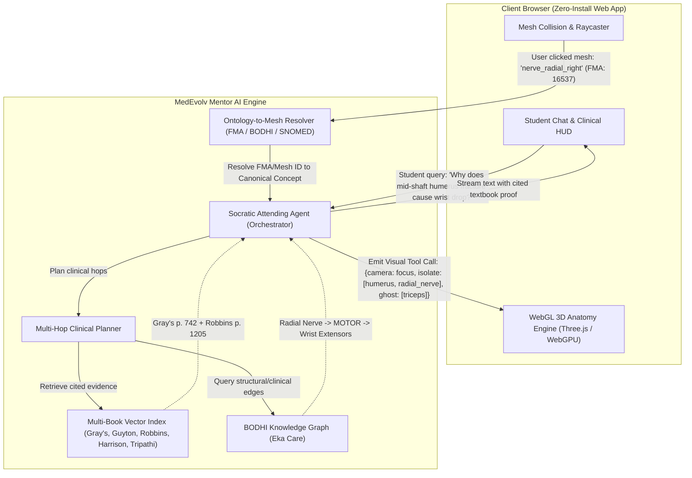

# Market & Competitor Analysis: 3D Anatomical Visualization & AI-Native Clinical Reasoning Systems

**Document Status:** Final Strategic Research Report  
**Author:** Senior Product & Market Strategy Research  
**Target Platform:** MedEvolv Mentor (`med-rag`)  
**Date:** November 2026  

---

## Executive Summary

The medical education technology (MedEdTech) landscape stands at a critical technological inflection point. For the past decade, the market has been strictly bifurcated into two disconnected silos:
1. **High-Fidelity 3D Anatomical Atlases** (e.g., *Complete Anatomy*, *BioDigital Human*, *Anatomage*): Exceptional spatial representations, CAD/cryosection-derived polygon meshes, and manual dissection tools that operate as visually stunning but semantically inert "digital plastic cadavers."
2. **Clinical Knowledge Engines & Question Banks** (e.g., *AMBOSS*, *Kenhub*, *Osmosis*): High-yield clinical summaries, USMLE-style question banks, and flashcard integrations that excel at diagnostic synthesis and spaced repetition, but rely almost exclusively on 2D illustrations, static plate overlays, or passive whiteboard animations.

In 2025–2026, generative AI and Vision-Language Models (VLMs) have triggered an urgent paradigm shift: **Conversational Spatial Grounding**. Medical students no longer want passive reference encyclopedias or static 3D viewers; they require an interactive, Socratic clinical tutor that can simultaneously reason through pathophysiology and dynamically manipulate the 3D anatomical environment in real time.

Current market incumbents suffer from either the **"Dumb 3D Model" problem** (graphics without clinical reasoning engines) or the **"Blind AI Chatbot" problem** (LLMs that hallucinate spatial relationships without viewport grounding). 

**MedEvolv Mentor** possesses a unique, defensible architectural advantage: a multi-hop clinical knowledge graph (BODHI) grounded in authoritative, peer-reviewed medical textbooks (*Gray's Anatomy*, *Guyton & Hall Physiology*, *Robbins Pathology*, *Tripathi Pharmacology*, *Harrison's Internal Medicine*). By coupling this validated RAG pipeline with a lightweight WebGL 3D anatomical viewer through an ontology-to-mesh mapping layer (FMA/BODHI/SNOMED CT), MedEvolv can leapfrog existing incumbents as **the world’s first truly AI-native 3D Clinical Reasoning Companion**.

---

## 1. Deep-Dive Competitor Benchmarking

### 1.1 Complete Anatomy (3D4Medical / Elsevier)

```
+-------------------------------------------------------------------------+
| COMPLETE ANATOMY (3D4Medical / Elsevier)                                |
+-------------------------------------------------------------------------+
| [Strengths]                                                             |
| * Industry-gold-standard 3D gross anatomy fidelity (>17,000 structures) |
| * Multi-planar radiological slice correlation (CT/MRI to 3D mesh)       |
| * Deep integration with Elsevier textbook IP (Gray's, Netter)           |
+-------------------------------------------------------------------------+
| [Architectural & Pedagogical Bottlenecks]                               |
| * Closed, proprietary C++/Metal/DirectX client app; heavy local runtime |
| * Zero conversational intelligence; text is static publisher pop-up data|
| * Linear, pre-authored courseware; no dynamic inquiry handling          |
+-------------------------------------------------------------------------+
```

#### Platform Architecture & UX Model
Acquired by Elsevier in 2019 for ~$50M, Complete Anatomy is widely considered the institutional gold standard for gross anatomy visualization in Western medical schools.
* **Client Architecture:** Built on a proprietary cross-platform C++/Metal/DirectX engine, distributed via native apps (macOS, Windows, iOS, iPadOS, Android). It does not offer a lightweight, zero-install WebGL student browser experience; runtime downloads range from 1.8 GB to 4.5 GB of encrypted asset bundles.
* **Interaction Model:** System-by-system tree hierarchy spanning 12 physiological systems (skeletal, connective, muscular, arterial, venous, lymphatic, nervous, respiratory, digestive, endocrine, urogenital, integumentary). A slider on the right viewport controls dissection depth layer-by-layer.
* **Dissection & Prosection Tools:** Users can select virtual scalpel tools to slice across structures, hide individual muscles, "peel" muscle groups, or inspect pre-made prosection specimens modeled from cadaveric dissections.

#### Radiological Slice View
Complete Anatomy features a dedicated **Radiology Suite**:
* Side-by-side or picture-in-picture viewport displaying multi-planar reconstructions (axial, coronal, sagittal) from clinical CT and MRI datasets.
* A synchronized cutting plane cuts through the 3D volumetric model as the user scrubs through 2D radiological DICOM slices.
* **Limitations:** The correlation is strictly geometric and visual; there is no underlying pathology reasoning. If a student observes an enlarged mediastinal shadow on the chest CT, the system cannot explain the clinical differential or dynamically link the lymph node enlargement to small-cell lung carcinoma.

#### Knowledge Linking & Educational Authoring
* **Elsevier Integration:** Directly links structures to excerpts from *Gray's Anatomy for Students*, Netter’s Atlas plates, and McMinn’s clinical dissections.
* **Curriculum Manager & Lecture Tools:** Instructors can record 3D camera animations, place 3D audio pins, assemble slide playlists, and distribute quizzes to students with grading dashboards.
* **Critical Bottleneck:** The curriculum is **100% pre-authored and immutable**. If a student has an exploratory clinical question (e.g., *"Why does this patient's Pancoast tumor cause Horner's syndrome instead of just arm pain?"*), Complete Anatomy provides no conversational reasoning. The user must leave the application and open Google, UpToDate, or AMBOSS.

---

### 1.2 BioDigital Human

```
+-------------------------------------------------------------------------+
| BIODIGITAL HUMAN                                                        |
+-------------------------------------------------------------------------+
| [Strengths]                                                             |
| * Browser-native WebGL/Three.js architecture; zero client footprint    |
| * Comprehensive HumanAPI (JS / iOS / Android SDKs) for programmatic UI |
| * Human Studio: visual authoring of multi-chapter 3D tours             |
+-------------------------------------------------------------------------+
| [Architectural & Pedagogical Bottlenecks]                               |
| * Platform is a developer SDK / authoring tool, NOT an intelligent tutor|
| * Annotations and tour logic are static JSON; zero RAG or reasoning     |
| * Expensive B2B SaaS licensing targeted at pharma and med-device OEMs   |
+-------------------------------------------------------------------------+
```

#### WebGL Platform & SDK Infrastructure
BioDigital pioneered the cloud-based, browser-first 3D human body model ("Google Earth for the human body").
* **Rendering Engine:** Proprietary WebGL/WebGPU pipeline (closely tied to Three.js abstractions) optimized for streaming progressive glTF/binary geometry over standard HTTP/WebSockets.
* **Embeddable Widgets & API:** BioDigital provides an iframe messaging API (`HumanAPI`) and native mobile wrappers (`HumanKit` for iOS/Android). Developers can embed models into any LMS, web page, or EHR with a few lines of JavaScript:
  ```javascript
  const human = new HumanAPI("embedded-human-iframe");
  human.on("scene.picked", (event) => {
    console.log("Clicked structure ID:", event.objectId);
  });
  ```

#### Programmatic Scene Control Methods
BioDigital's SDK exposes direct scene manipulation methods that represent the current state-of-the-art for programmatic 3D interaction:
* `human.camera.flyTo({ eye, look, up, velocity })`: Smooth lerped camera transitions to specific anatomical coordinates.
* `human.scene.isolate([objectIds])`: Fades or removes all structures outside the specified ID list.
* `human.scene.highlight([objectIds], { color, intensity })`: Outlines or tints target meshes.
* `human.scene.xray([objectIds])`: Renders target meshes as semi-transparent ghosted structures to reveal deeper vascular/nerve pathways.
* `human.annotations.create({ id, title, description, position })`: Anchors HTML callouts to 3D world coordinates with 2D screen tracking.

#### Virtual Tour Builder & Conditional Tagging (Human Studio)
* **Human Studio:** A web-based authoring suite where non-technical educators or medical illustrators can create multi-chapter 3D presentations (e.g., Chapter 1: Normal Coronary Artery -> Chapter 2: Atherosclerotic Plaque Accumulation -> Chapter 3: Thrombus & Myocardial Infarction).
* **Conditional Labels:** Tags can be set to hide on load, trigger on click, or toggle visibility based on camera distance (LOD tagging).
* **Critical Bottleneck:** BioDigital is an **authoring framework, not an educational companion**. Every single chapter, camera angle, and textual annotation must be manually authored and saved as static JSON scene descriptors. It contains zero autonomous medical reasoning, no clinical ontology traversal, and no ability to synthesize real-time textbook answers to novel student questions.

---

### 1.3 AMBOSS & Kenhub

```
+-------------------------------------------------------------------------+
| AMBOSS & KENHUB                                                         |
+-------------------------------------------------------------------------+
| [Strengths]                                                             |
| * AMBOSS: Undisputed gold standard for USMLE Step 1/2 CK & clinical reasoning|
| * Kenhub: Best-in-class systematic gross anatomy & histology atlas      |
| * High-yield QBank, Anki add-on, and active-recall spaced repetition    |
+-------------------------------------------------------------------------+
| [Architectural & Pedagogical Bottlenecks]                               |
| * Trapped in 2D: AMBOSS uses flat illustrations with 2D PNG overlay masks|
| * Kenhub uses pre-rendered pseudo-3D rotating sprite sheets or fixed 3D |
| * No dynamic spatial manipulation; complete cognitive separation between|
|   spatial anatomy and high-yield pathophysiology                       |
+-------------------------------------------------------------------------+
```

#### AMBOSS: Clinical Synthesis & 2D Overlays
* **Content Engine:** 1,400+ peer-reviewed clinical articles, linked to a 6,000+ question bank (QBank) with granular difficulty scoring ("Hammer" rating) and attending physician reasoning pearls.
* **Visual Tools (2D Overlay & Smart Zoom):**
  * *Image Overlays:* Instead of interactive 3D, AMBOSS overlays color-coded vector/bitmap masks on static 2D CT scans, X-rays, and medical illustrations (e.g., highlighting the territory of the middle cerebral artery in green).
  * *Smart Zoom:* Allows smooth zooming into ultra-high-resolution 2D histology and pathology plates down to the cellular level.
* **Anki Integration:** The AMBOSS Anki add-on is one of the most widely adopted tools in modern medical training. Hovering over any medical term inside an Anki flashcard displays an instant popup definition and links directly to the AMBOSS knowledge library.
* **The Disconnect:** AMBOSS provides exceptional clinical depth, but its visual learning is completely flat. Students preparing for surgical rotations or anatomy practicals cannot understand relational depth (e.g., the spatial relationship between the femoral nerve, artery, vein, and canal from lateral to medial: **NAVeL**) through static 2D images.

#### Kenhub: Structural Mastery & Spaced Repetition
* **Pedagogical Strategy:** Focused strictly on preclinical gross anatomy, neuroanatomy, and histology. Kenhub uses high-yield colored vector illustrations and structured tables (Origin, Insertion, Innervation, Action - OIIA).
* **Active Recall Testing:** Features timed spotter quizzes (identifying highlighted structures on atlas plates) powered by a Leitner spaced-repetition algorithm.
* **The Disconnect:** Kenhub teaches structure in a vacuum. It provides minimal clinical context, no multi-hop pharmacological or pathophysiological reasoning, and does not prepare students for clinical case vignettes where anatomical knowledge must be applied to diagnostic decisions.

#### The Current Student Study Workflow (The "Fragmented Stack")
Today's medical student is forced to juggle 4–6 disconnected applications simultaneously:
```
[Preclinical Anatomy]      [Spatial Exploration]      [Clinical Correlation]      [Active Retention]
     Kenhub / Netter   -->   Complete Anatomy    -->      AMBOSS / First Aid  -->      Anki Flashcards
     (Static Plates)           (3D Viewer)                 (Text Articles)           (Spaced Repetition)
```
Students constantly lose context switching between these platforms. When studying a clinical vignette in AMBOSS, they have to open Complete Anatomy to visualize the lesion site, then jump into Anki to memorize the innervation.

---

### 1.4 Osmosis & Anatomage

```
+-------------------------------------------------------------------------+
| OSMOSIS & ANATOMAGE                                                     |
+-------------------------------------------------------------------------+
| [Anatomage Table]                                                       |
| * 1:1 scale virtual dissection on cryosection cadavers (Visible Human)  |
| * Full DICOM volumetric rendering, surgical cuts, hemodynamics          |
| * Barrier: $60,000 - $120,000 hardware table; locked to institutional labs|
+-------------------------------------------------------------------------+
| [Osmosis]                                                               |
| * Engaging 2D whiteboard animated videos & clinical mnemonics           |
| * Concept-heavy, accessible, broad coverage across preclinical blocks   |
| * Barrier: Completely passive 2D consumption; zero spatial manipulation |
+-------------------------------------------------------------------------+
```

#### Anatomage: High-End Hardware Dissection
* **Platform:** Full-scale digital operating table featuring two or three networked 4K multi-touch displays. Powered by real cryosection data from the Visible Human Project and the Visible Korean Human (segmented at 0.1 mm resolution into >2,500 individual anatomical structures).
* **Clinical Capabilities:**
  * Direct DICOM volumetric rendering (CT/MRI/CBCT).
  * Digital scalpel slicing along any oblique angle.
  * Real-time physiological simulations (beating 4-chamber heart with valvular hemodynamics, respiratory excursion, gas exchange at the alveolus).
  * Pathology library with real DICOM scans of aortic aneurysms, glioblastomas, bone fractures, and metastatic tumors.
* **Critical Bottleneck:** High capital expense ($60k–$120k per table). It is an institutional asset locked in physical university anatomy labs. Students cannot take it home or use it on their laptops for daily study. Furthermore, Anatomage provides **zero conversational guidance**—it is a visual hardware simulator, not an AI mentor.

#### Osmosis: Animated Whiteboard Pedagogy
* **Platform:** Elsevier-owned video platform famous for 10-minute animated whiteboard explanations of pathophysiological mechanisms and pharmacological pathways.
* **Pedagogical Model:** High-retention visual mnemonics, concept mapping, and scripted voiceover walkthroughs.
* **Critical Bottleneck:** 100% passive video consumption. The spatial layout is purely illustrative and metaphorical (e.g., drawing a renin-angiotensin-aldosterone axis as a factory conveyor belt). It provides no genuine 3D spatial anatomy.

---

## 2. Feature Comparison & Competitive Benchmarking Matrix

| Capability / Dimension | Complete Anatomy (Elsevier) | BioDigital Human | AMBOSS | Kenhub | Anatomage Table | MedEvolv Mentor (Target State) |
|---|---|---|---|---|---|---|
| **Platform Delivery** | Heavy native apps (Win/Mac/iOS) | WebGL browser / Mobile SDK | Web responsive / Anki plugin | Web responsive / Mobile apps | Proprietary 4K touchscreen table | **Lightweight WebGL (Three.js) in Browser** |
| **3D Mesh Manipulation** | Virtual scalpel, 12-layer slider, isolate | API flyTo, isolate, highlight, xray | None (2D only) | Fixed 3D rotates / 2D plates | True multi-planar volumetric slice | **LLM-driven flyTo, ghost, isolate, clip planes** |
| **Radiological Correlation** | Multi-planar CT/MRI synchronized | None | 2D toggleable overlay masks | Basic X-ray/MRI label overlays | Full volumetric 3D DICOM rendering | **Synchronized 2D DICOM/CT slice + 3D cross-section** |
| **Clinical Reasoning Engine** | None (Static textbook quotes) | None | Curated editorial clinical articles | Basic clinical notes | Static DICOM case notes | **Multi-hop RAG (BODHI Graph + 6 Core Textbooks)** |
| **Conversational AI Tutor** | None | None | Emerging basic chatbot (isolated text) | None | None | **Native Socratic Attending with 3D Spatial Awareness** |
| **Text-to-3D Control** | Manual search & click only | Scripted via HumanAPI JS | None | None | Manual multi-touch UI | **Real-time tool calls emitted by LLM stream** |
| **3D-to-Text Inspection** | Static label + textbook excerpt | JSON title & description popup | N/A | Static OIIA table | Static anatomical metadata | **Dynamic clinical synthesis + auto-generated vignettes** |
| **Knowledge IP Grounding** | Elsevier proprietary (*Gray's*) | In-house medical illustrators | Editorial board clinical consensus | In-house anatomical illustrators | Real cadaver segmentations | **Harrison, Robbins, Gray's, Guyton, Tripathi, Davidson** |
| **Hardware / Cost Barrier** | High subscription ($40–$100/yr / institutional) | B2B enterprise licensing ($$$) | Subscription ($15–$30/mo) | Subscription ($20–$40/mo) | Extreme ($60k–$120k capital purchase) | **Zero-install web app; consumer/student SaaS** |

---

## 3. AI-Native Medical Learning: State-of-the-Art (2025–2026)

The emergence of multimodal Vision-Language Models (VLMs) and Agentic Tool Calling in 2025–2026 has opened entirely new paradigms in medical education that make static 3D viewers obsolete.

### 3.1 Conversational Spatial Grounding
Until recently, LLMs were "spatially blind": they could explain the theoretical course of the recurrent laryngeal nerve, but had no conception of coordinates, mesh boundaries, or visual perspective. 
Recent research breakthroughs have introduced **Conversational Spatial Grounding**:
* **Textual Anatomy Encoding (TAE) & 3D Grounding:** Systems that translate natural language tokens into explicit 3D bounding boxes, mesh identifiers, and camera viewpoints (e.g., CUBE-LLM, GR3D, SEER MICCAI 2026).
* **Ontological Mesh Anchoring:** By mapping open medical ontologies—such as the **Foundational Model of Anatomy (FMA)**, **Uberon**, **SNOMED CT**, and **BODHI**—to unique 3D mesh identifiers (`fma_id`, `mesh_id`), the LLM can treat 3D visual scenes as structured, actionable state graphs.

### 3.2 Dynamic Viewport Control Triggered by LLM Reasoning
Rather than expecting the student to manually rotate, pan, zoom, and dissect through 12 layers of muscle to find a deep structure, the AI reasoning stream outputs **structured visual action tool-calls** interleaved with natural language explanations.
When an AI tutor explains:
> *"In a mid-shaft humeral fracture, the radial nerve is vulnerable as it runs in the radial groove along the posterior surface of the humerus..."*

The AI simultaneously emits an asynchronous scene execution payload:
1. `camera.focus_on(["radial_nerve_right", "humerus_shaft_right"])`
2. `scene.isolate(["humerus_right", "radial_nerve_right", "profunda_brachii_artery"])`
3. `scene.ghost(["triceps_brachii_lateral_head", "deltoid_right"], opacity=0.15)`
4. `scene.annotate("Radial Groove: Frequent site of entrapment -> Wrist Drop", target="radial_nerve_right")`

The student's browser viewport smoothly animates to the exact posterior view, ghosts the overlying triceps muscle, and pulses the radial nerve in neon blue while the text explanation streams on the side.

### 3.3 Dynamic Socratic Clinical Simulations
Instead of traditional multiple-choice questions (MCQs), the AI companion orchestrates an **interactive spatial patient case**:
1. **Presentation:** AI presents a clinical vignette: *"A 45-year-old male presents with sudden hoarseness following a subtotal thyroidectomy."*
2. **Interactive Spatial Challenge:** AI asks the student: *"Using your 3D view, inspect the thyroid bed and dissect away the strap muscles to identify which nerve structure was most likely injured during ligation of the inferior thyroid artery."*
3. **Student Interaction:** The student rotates the model, hides the sternothyroid muscle, and clicks on the *left recurrent laryngeal nerve*.
4. **Pedagogical Evaluation:** The system captures the raycast event, verifies the target against the BODHI graph edge (`Thyroidectomy -> COMPLICATION -> RecurrentLaryngealNerveInjury`), and responds:
   > *"Spot on. The recurrent laryngeal nerve ascends in the tracheoesophageal groove and passes intimate to the branches of the inferior thyroid artery. Injury leads to paralysis of the intrinsic laryngeal muscles (except the cricothyroid), resulting in hoarseness. Which muscle does the cricothyroid receive its innervation from instead?"*

---

## 4. Interaction Patterns: Text-to-3D and 3D-to-Text

To build an AI-native 3D companion, MedEvolv must establish rigorous, standardized bi-directional interaction protocols between the LLM RAG engine and the WebGL canvas.

```
                    +--------------------------------------------+
                    |          MedEvolv Mentor Backend           |
                    |  (BODHI Knowledge Graph + Multi-Hop RAG)  |
                    +---------------------+----------------------+
                                          |
                Text-to-3D Actions        |        3D-to-Text Queries
             (Structured Tool Payloads)   |     (Raycast Node Resolution)
                                          |
                                          v
                    +---------------------+----------------------+
                    |          WebGL Three.js Viewport           |
                    |       (Client Browser Anatomy Engine)      |
                    +--------------------------------------------+
```

### 4.1 Text-to-3D Interaction Patterns

The LLM outputs structured visual commands via JSON tool-calling or embedded markdown visual action directives. The WebGL frontend interprets these actions and executes smooth transitions:

```json
{
  "action": "scene_orchestration",
  "camera": {
    "target_structure": "inguinal_canal_right",
    "view_angle": "anterolateral_oblique",
    "distance": 0.45,
    "transition_duration_ms": 1200
  },
  "mesh_operations": [
    {
      "op": "highlight",
      "mesh_ids": ["deep_inguinal_ring", "superficial_inguinal_ring"],
      "color": "#3B82F6",
      "pulse": true
    },
    {
      "op": "ghost",
      "mesh_ids": ["external_oblique_aponeurosis", "internal_oblique_muscle"],
      "opacity": 0.2
    },
    {
      "op": "isolate",
      "mesh_ids": [
        "inguinal_canal_contents_male",
        "inferior_epigastric_artery",
        "transversalis_fascia",
        "conjoint_tendon"
      ]
    },
    {
      "op": "add_cross_section_plane",
      "plane": "sagittal",
      "offset": 0.12,
      "show_radiological_cut": true
    }
  ],
  "annotations": [
    {
      "mesh_id": "inferior_epigastric_artery",
      "text": "Landmark: Direct hernia occurs medial to this artery; Indirect hernia lateral.",
      "leader_line": true
    }
  ]
}
```

#### Core Visual Primitives:
1. **Camera Framing (`flyTo`):** Lerped cubic bezier camera motions that keep the anatomical region centered regardless of previous user rotation.
2. **Contextual Ghosting / X-Ray:** Rather than brutally hiding surrounding structures (which disorients the student’s spatial reference), non-pertinent anatomy is rendered with an inverted Fresnel rim shader at 10–20% opacity.
3. **Anatomical Tracing:** Flowing particle animations showing the direction of arterial blood, venous return, lymphatic drainage, or neural action potential propagation.
4. **Cross-Sectional Clipping Planes:** Interactive slider planes that cut across gross anatomy to reveal relational interior architecture (e.g., the four chambers of the heart, the renal medulla vs. cortex, or brain sulci).

---

### 4.2 3D-to-Text Interaction Patterns

When a student clicks, hovers, or dissects a structure in the 3D canvas, the frontend resolves the 3D raycast to a canonical ontology entity and triggers targeted clinical workflows:

```
[Student Clicks 3D Mesh]
       |
       v (Raycast Collision)
[Mesh ID: "nerve_femoral_right" -> FMA: 16535 -> BODHI Concept: "Femoral Nerve"]
       |
       +--------------------------------------------------------------+
       |                                                              |
       v                                                              v
[Instant Quick-Card (UI Overlay)]            [Conversational Prompt Injected]
* Sensory: Anterior thigh, saphenous nerve    * "Explain the clinical motor & sensory
* Motor: Quadriceps femoris, pectineus          deficits if this nerve is damaged
* Reflex: Patellar tendon (L2-L4)               in the femoral triangle."
* Textbook Provenance: Gray's p. 542           * RAG multi-hop retrieval across
                                                Gray's, Guyton, and Harrison
```

#### Interaction Modes Triggered by 3D Picking:
1. **"Inspect & Synthesize" Mode:**
   * Clicking a structure opens a concise HUD pill showing:
     * **Official Terminologia Anatomica** name and synonyms.
     * **Neurovascular Pedicle:** Arterial supply, venous drainage, nerve innervation, lymphatic basin.
     * **Direct Textbook Citations:** One-click links to exact pages in *Gray's Anatomy*, *Guyton Physiology*, or *Robbins Pathology*.
2. **"Generate Clinical Vignette" Button:**
   * Clicking the button sends a prompt to MedEvolv: *"Generate a high-yield USMLE Step 1 case vignette involving pathology or trauma to this specific structure."*
   * The AI generates a patient scenario (e.g., pelvic surgery complications, iatrogenic nerve transection) where the clicked structure is the root cause.
3. **"Differential & Adjacent Pathology" Graph Hop:**
   * Tapping an organ (e.g., *Head of the Pancreas*) queries the BODHI clinical graph to highlight adjacent anatomical risks:
     * Bile duct compression -> Obstructive jaundice (`Robbins p. 892`).
     * Duodenal invasion -> Gastric outlet obstruction (`Harrison ch. 344`).
     * Superior mesenteric vessel encasement -> Surgical unresectability (`Davidson p. 810`).
   * The 3D scene immediately updates to highlight each of these threatened adjacent vessels and organs in warning amber.

---

## 5. Market Vulnerabilities & Competitor Gaps

Our benchmarking reveals four massive strategic vulnerabilities across all existing market leaders:

```
+----------------------------------------------------------------------------------------------------+
|                                    THE FOUR COMPETITOR GAPS                                        |
+----------------------------------------------------------------------------------------------------+
| 1. THE "DUMB 3D MODEL" GAP                                                                         |
|    Complete Anatomy & BioDigital look gorgeous, but have ZERO medical intelligence. They cannot    |
|    reason, cannot explain multi-hop disease mechanisms, and cannot answer free-form student queries.|
+----------------------------------------------------------------------------------------------------+
| 2. THE "BLIND AI CHATBOT" GAP                                                                      |
|    Generic LLM medical chatbots (ChatGPT, generic Med-PaLM wrappers) know text, but cannot "see",   |
|    cannot point to coordinates, and have zero spatial grounding in 3D WebGL scenes.                |
+----------------------------------------------------------------------------------------------------+
| 3. RIGID, NON-EXPLORATORY LINEAR PATHWAYS                                                          |
|    Current tools enforce static, pre-recorded lectures and fixed slide decks. When a curious        |
|    student asks an adjacent question, the system hits a dead end.                                  |
+----------------------------------------------------------------------------------------------------+
| 4. FRAGMENTED WORKFLOW TAX & HIGH PRICING                                                          |
|    Students must buy 3D software ($50/yr), QBank ($30/mo), video libraries ($20/mo), and hardware.  |
|    Cognitive friction from switching apps severely degrades retention and study flow.              |
+----------------------------------------------------------------------------------------------------+
```

1. **The "Dumb 3D Model" Gap:**
   Incumbents like Complete Anatomy have poured tens of millions into high-polygon 3D modeling and radiological registration, but their textual layer is static publisher data. They are digital museum exhibits. They cannot generate dynamic differentials, explain drug-target mechanisms at the tissue level, or tailor their explanations to a student’s specific confusion.
2. **The "Blind AI Chatbot" Gap:**
   Emerging Med-AI chatbots (e.g., generic GPT-4o or Claude 3.5 Sonnet medical interfaces) can spit out paragraphs of text from Harrison's or First Aid, but they suffer from total visual detachment. They cannot point to the deep inguinal ring, cannot show what happens to the median nerve under the flexor retinaculum, and cannot visually guide a student through a surgical triangle.
3. **Rigid, Non-Exploratory Linear Courseware:**
   Existing interactive courses in Complete Anatomy or Osmosis are strictly scripted video or slide playlists. If a student wants to explore: *"What if the stab wound was 2 cm higher, just above the transpyloric plane?"*, existing systems cannot adapt. They can only replay the same pre-rendered asset.
4. **The Fragmented Toolchain Tax:**
   Medical students suffer from tool fatigue. Paying separately for Complete Anatomy (for gross anatomy lab), AMBOSS (for clinical rotations and shelf exams), Kenhub (for histology memorization), and Anki (for flashcards) creates high cognitive friction, disorganized notes, and duplicated subscription costs.

---

## 6. Strategic Opportunities for MedEvolv Mentor

MedEvolv Mentor is positioned to become **the category-defining AI-Native 3D Clinical Reasoning Companion**.

### 6.1 The MedEvolv Architectural Advantage
MedEvolv already possesses what the 3D graphics companies lack:
* **BODHI Knowledge Graph Integration:** Clinical triples linking symptoms, conditions, drug treatments, lab findings, and anatomical targets (`triples.jsonl` and `nl_facts.jsonl` from Eka Care).
* **Multi-Hop Textbook RAG Pipeline:** Verified ingest and indexing across the definitive canonical medical curriculum:
  * *Gray's Anatomy for Students 5e* (Structural anatomy + figure labels)
  * *Guyton and Hall Medical Physiology 14e* (Mechanisms, homeostasis, and hemodynamics)
  * *Robbins & Cotran Pathologic Basis of Disease 10e* (Cellular pathology & gross organ changes)
  * *KD Tripathi Essentials of Medical Pharmacology 7e* (Drug classes, mechanisms, receptors)
  * *Harrison's Principles of Internal Medicine 22e* & *Davidson 24e* (Clinical practice, differentials, management)
* **Ontology Reinforcement Engine:** A certified clinical ontology layer mapping conditions, clinical stages, manifestations, and diagnostic pathways.

By connecting this knowledge backbone to a lightweight, open-source 3D WebGL anatomy engine, MedEvolv transforms from a pure text RAG system into a **fully grounded multimodal clinical intelligence platform**.

---

### 6.2 Target System Architecture

The following diagram illustrates how MedEvolv Mentor bridges natural language, clinical knowledge graphs, multi-hop textbook evidence, and 3D WebGL viewport state:



---

### 6.3 Phased Implementation Roadmap for MedEvolv

```
+-------------------------------------------------------------------------+
| MEDEVOLV ROADMAP: FROM TEXT RAG TO 3D CLINICAL COMPANION               |
+-------------------------------------------------------------------------+
| PHASE 1: MESH-ONTOLOGY GROUNDING (Foundation)                           |
| - Integrate open-access segmented 3D anatomy glTF models (Zygote/BodyParts3D) |
| - Map 3D mesh identifiers to FMA IDs, SNOMED CT, and BODHI graph nodes  |
| - Implement WebGL Three.js client viewer with basic raycasting & hover  |
+-------------------------------------------------------------------------+
| PHASE 2: BI-DIRECTIONAL TEXT <-> 3D INTERACTION (MVP)                   |
| - Define LLM tool-calling schema: scene_focus, isolate, ghost, label    |
| - LLM streams textbook RAG answers while dynamically moving the 3D scene|
| - Clicking any 3D mesh queries MedEvolv RAG and auto-populates HUD info |
+-------------------------------------------------------------------------+
| PHASE 3: SOCRATIC 3D CLINICAL CASE SIMULATIONS (Differentiation)       |
| - Attending Physician agent mode presenting realistic patient vignettes |
| - Student must identify lesion site or surgical window directly in 3D   |
| - Dynamic Socratic feedback: evaluates spatial precision + pathophysiology|
+-------------------------------------------------------------------------+
| PHASE 4: RADIOLOGICAL SLICE & MULTIMODAL CORRELATION (Market Domination)|
| - Synchronized 2D DICOM CT/MRI slice viewer correlated with 3D models   |
| - Multi-hop cross-referencing: Anatomy -> Radiology -> Pathology -> Rx  |
| - Export high-yield cards directly to Anki with 3D camera deep links    |
+-------------------------------------------------------------------------+
```

#### Phase 1: Mesh-Ontology Grounding Layer
* **3D Asset Pipeline:** Adopt optimized, high-fidelity anatomical meshes (e.g., from BodyParts3D / open anatomical repositories or licensed glTF models) segmented down to individual muscles, bones, nerves, and arteries.
* **Ontology Alignment:** Create an explicit mapping table:
  `Mesh_ID (e.g., "right_recurrent_laryngeal_nerve") <---> FMA_ID (46664) <---> BODHI Node <---> Gray's Section Heading`.
* This leverages MedEvolv's recent work in `ingest/grays_toc.py` and `docs/anatomy_fix.md`, where figure labels and heading paths were mapped directly to the chunk index.

#### Phase 2: Bi-Directional Interaction Engine
* Enable the LLM to emit inline visual actions alongside markdown text.
* Provide the student with instant structural feedback: clicking on a bone, nerve, or organ immediately generates an authoritative multi-book summary (Anatomy from *Gray's*, Physiology from *Guyton*, Pathology from *Robbins*, Treatment from *Tripathi* / *Harrison*).

#### Phase 3: Socratic 3D Clinical Case Simulations
* Launch interactive virtual patient encounters: the student acts as the junior resident on clinical rounds.
* Instead of reading a static vignette, the student must examine the patient's 3D anatomy, perform virtual diagnostic procedures (e.g., identifying the landmark for a lumbar puncture between L3/L4 or L4/L5), and defend their diagnosis using textbook citations.

#### Phase 4: Full Multi-Modal Synthesis & Anki Workflow
* Add synchronized multi-planar DICOM correlation.
* Integrate an official MedEvolv Anki sync: when a student misses a card, clicking the card deep-links directly into MedEvolv’s WebGL viewport, positioning the 3D camera at the exact angle needed to reinforce the anatomical concept.

---

## 7. Conclusion: The MedEvolv Value Proposition

The competitive landscape proves that **visual fidelity without clinical reasoning is hollow**, while **clinical reasoning without spatial grounding is incomplete**.

* Complete Anatomy and BioDigital are visual masters that lack a clinical brain.
* AMBOSS and Kenhub are educational masters trapped in a 2D printing-press paradigm.
* Anatomage is a magnificent hardware display trapped by a $100,000 price tag.

**MedEvolv Mentor** has the unique opportunity to fuse these two worlds. By grounding a responsive, browser-native 3D WebGL viewport in the multi-hop clinical intelligence of the BODHI graph and six authoritative medical textbooks, MedEvolv will deliver an unmatched learning companion: **a tireless, Socratic attending physician that can show you exactly what it's talking about, in 3D, anywhere in the world.**
