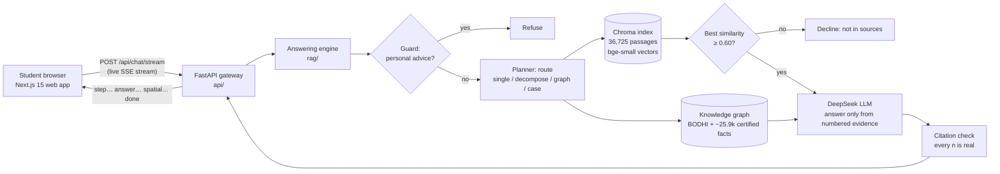
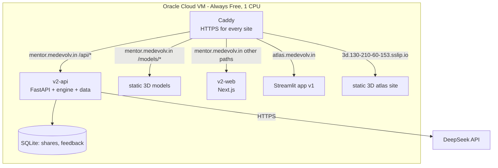

# MedEvolv Mentor: team guide

*For: the whole team, before the 17 Nov 2026 presentation to the AI and MBA panels. Written 15 Nov 2026.*
*You do not need a medical background to read this. Medical words are explained in the footnotes (marked ¹, ², …) and in the glossary in Part 6.*

**Files in this folder**
- `TEAM_GUIDE.md` (this file): the full guide.
- `team_guide.html`: the same guide as one web page, with diagrams. Open it in any browser.
- `floorplan.html`: an interactive map of the system ("floorplan"). Open it, press **Start here**, then **Flows → A question walks through the building**.

---

## The one-minute version (read this if nothing else)

| | |
|---|---|
| **What it is** | A chatbot for Indian medical (MBBS) students that answers **only from 7 standard textbooks**, shows the **book, chapter and pages** for every claim, and **says "not in my sources"** instead of guessing. |
| **Why it exists** | Students increasingly ask general chatbots, which answer confidently with no source. In medicine, an unsourced wrong answer is worse than no answer. |
| **What's live** | https://mentor.medevolv.in (the main app, "v2"). Backup: https://atlas.medevolv.in (the first Streamlit version, same engine). |
| **The core technique** | RAG (Retrieval-Augmented Generation): search the textbooks first, then let a language model (DeepSeek) write an answer using only what was found, then check every citation in code. |
| **Our enhancement** | Query decomposition and routing: a two-topic question is split into parts and each part is searched separately; clinical cases go through a symptom graph. |
| **Headline numbers** | 39/39 correct behaviour on our 39-question test set; 30/30 answers carry citations; right chapter in the top 3 search results 90.8% of the time (446 pharmacology questions); about 3 s per answer. |
| **Honest caveats** | These are our own test sets, not a clinical-safety claim. In an 18-case hard clinical review, 12 had a "major" issue. We have no licence for the textbooks yet. |
| **Demo day rule** | Don't redeploy on the day. Land the 5-minute core first, then add extension modules if they let us run long. |

---

# Part 1. Step-by-step guide

## 1.1 What the project is (in plain words)

Think of a very careful librarian:

1. You ask a question.
2. The librarian first checks whether you're asking for **personal medical advice** (e.g. "what dose should my mother take?"). If so, they politely refuse: this is a study aid, not a doctor.
3. Otherwise they **search seven textbooks** for the six most relevant short passages.
4. If nothing relevant is found (the best match is too weak), they say **"not in my sources"** and stop. The writer is never even asked.
5. If relevant passages are found, a **writer** (the DeepSeek language model) drafts an answer **using only those numbered passages**, and must put a citation like [2] after every claim.
6. Finally, a **checker** (plain code, not AI) verifies that every [n] in the answer points at a passage that was actually handed over.

That's "cite-or-decline". Everything else (the graph, the 3D atlas, the Why page) is built around that core.

**The seven textbooks** (only names and chapters are ever shown publicly, never their text):

| Short name | Book | Subject (plain English) |
|---|---|---|
| Tripathi | KD Tripathi, *Essentials of Medical Pharmacology* | drugs: how they work, uses, side effects |
| Guyton | Guyton & Hall, *Medical Physiology* | how the healthy body works |
| Robbins | Robbins & Cotran, *Pathologic Basis of Disease* | what goes wrong in disease (pathology) |
| Davidson | *Davidson's Principles and Practice of Medicine* | clinical medicine (diagnosis and treatment) |
| Harrison | *Harrison's Principles of Internal Medicine* | comprehensive internal medicine |
| Microbiology | *Essentials of Medical Microbiology* | bacteria, viruses, parasites, tests |
| Gray's | *Gray's Anatomy for Students* | anatomy (body structures) |

## 1.2 Why it exists

- **User:** Indian MBBS students (years 1 to 4.5) and interns studying for university professional exams and *vivas*¹ from these standard books.
- **Problem:** general chatbots answer without a page reference and rarely admit when they don't know. Students can't check them against the book they will be examined on.
- **Our answer:** every claim points at a page in a book the student already uses, and the bot declines rather than guesses.
- **Most-loved feature for students:** *Why was I wrong?* Students spend a lot of time on MCQs² and getting them wrong; this turns a wrong MCQ into a short, cited revision session.

## 1.3 How we got here (milestones)

| Date (2026) | Milestone |
|---|---|
| 7 Nov | Baseline RAG over KD Tripathi. Book structure recovered from the table of contents (and from bold heading fonts where the PDF had none). Multi-hop answering added: query decomposition plus the BODHI symptom graph. Router and STAIR experiments started. Eval harness built. |
| 12 Nov | Demo hardening: experiments hidden behind a flag; DeepSeek chosen as the answer model; 36-question product eval; deployed to an Oracle Cloud VM with HTTPS; renamed **MedEvolv Mentor**; live step-by-step trace in the UI; Harrison's added; ontology (verified fact graph) work begins. |
| 13 Nov | Long clinical cases split along three clinical axes ("case" route). Ontology quality pass (quotes must support facts). STAIR closed as a negative result. Gray's Anatomy added (7 books, 36,725 passages). Evaluation re-run: 39/39. Dark mode and phone layout. |
| 14 Nov | Demo rehearsal: 9/9 steps pass. Patient drug-check experiment run and **kept off** because it made clinician reviews worse (documented negative result). 3D atlas links pruned for accuracy. |
| 15 Nov | Strategy review (market, GTM, licensing, SOM). **v2** built: Next.js web app + FastAPI gateway with live streaming, Why was I wrong?, Explore + concept pages, native 3D atlas, share links, feedback, and the scroll-driven "How it works" story. |
| 16 Nov | v2 deployed to **mentor.medevolv.in**; Streamlit moved to atlas.medevolv.in as the fallback; dry run on the live site with timings. |
| 17 Nov | Presentation. |

## 1.4 Run it locally

You need: the textbook data folder (`data/`, private, not in git; ask the project owner), Python 3.13, Node with `pnpm`, and a DeepSeek API key in a `.env` file at the repo root (`.env` is git-ignored; never paste it into chat or commit it).

1. Get the repo and the data:
   ```bash
   cd ~/Projects/med-rag
   ```
2. Create the Python environment (first time only):
   ```bash
   python3.13 -m venv .venv && .venv/bin/pip install -r requirements.txt
   ```
3. Make sure `.env` has at least `LLM_BACKEND=deepseek`, `EMBED_BACKEND=local` and your `DEEPSEEK_API_KEY`. (Default without it is a local Ollama model.)
4. (Only if the index is missing) build the library index. About 6 minutes on a laptop:
   ```bash
   .venv/bin/python -m rag.index
   ```
5. Quick check from the command line, no UI:
   ```bash
   .venv/bin/python -m rag.answer --hops "Compare the mechanism of action of penicillins and aminoglycosides."
   ```
6. Start the API gateway (terminal 1):
   ```bash
   .venv/bin/uvicorn api.main:app --port 8000
   ```
7. Start the web app (terminal 2). It forwards `/api` to port 8000:
   ```bash
   pnpm install && pnpm --dir apps/web dev
   ```
8. Open http://localhost:3000. The first question after a restart is slow (~11–20 s, loading models); later ones take 3–6 s.
9. Optional, the Streamlit fallback:
   ```bash
   .venv/bin/streamlit run app.py
   ```
10. Run the tests (no real model calls; the LLM is stubbed):
   ```bash
   .venv/bin/pytest -q
   ```

## 1.5 Deploy (owner only; **never on demo day**)

Everything runs on **one Oracle Cloud VM** (Always Free tier). **Caddy** (a web server) sits in front and gives each site its HTTPS certificate automatically. Each app runs in a **Docker** container.

| Address | What it serves | How it's deployed |
|---|---|---|
| mentor.medevolv.in | **v2**: Next.js web app + FastAPI gateway | `deploy/v2/push.sh <vm-ip>` from your Mac |
| atlas.medevolv.in | Streamlit fallback (v1) | `deploy/oci/push.sh <vm-ip>` from your Mac |
| 3d.130-210-60-153.sslip.io | the static 3D atlas site | `deploy/atlas/build_atlas.sh` then `deploy/atlas/push_atlas.sh` |

Steps for a v2 deploy:
1. Commit and test locally first (`pytest -q`).
2. Check `.env` has `DEEPSEEK_API_KEY` (the script stops if not; it copies only the variables the server needs and never prints them).
3. Run `deploy/v2/push.sh <vm-ip>`. It builds the web app **on your Mac** (the VM has 1 CPU), copies web + API code to `~/v2` on the VM, starts the two containers, and adds the mentor block to Caddy after validating it (no downtime for the other sites).
4. Note: the v2 API image is built *from* the Streamlit app's image (`eka-app`), which is where the `data/` index lives. So the Streamlit deploy must exist first.
5. After a deploy, warm it: ask one question, wait for the answer.

## 1.6 Demo it (17 Nov)

The full script is `docs/demo_script_presentation.md`. The summary:

**Pre-flight (T-10 minutes)**
1. Open four tabs in order: `/how`, `/` (Ask), `/why`, and the optic-chiasm concept page `/c/MED%3AOKF%2Fanatomicalstructure%2Foptic-chiasm`.
2. Warm the server: ask one question on Ask, then press *Clear chat*.
3. Open the optic-chiasm tab once so the 3D models (32 MB) are cached.
4. Zoom the browser to 125%; use the light theme on a projector.
5. Use the same laptop and browser profile on stage; phone hotspot if venue Wi-Fi is weak.

**5-minute core**
| Time | Tab | What to do | What to say (short) |
|---|---|---|---|
| 0:00–0:50 | `/how` | Scroll to the seven-textbooks card | "Answers only from the textbooks, shows the page for every claim, says so when the books don't cover it." 36,725 passages. |
| 0:50–1:50 | Ask | Tap **Compare · split into parts**; point at the trace; tap citation [1] | "It recognised two topics and split the question: our enhancement." Tell the failure story (below). |
| 1:50–2:20 | Ask | Tap **Watch it decline**, then **Watch it refuse** | "Not in the books, so it won't guess." / "Study aid, not medical advice." |
| 2:20–3:20 | `/why` | **Try an example**, then **Why was I wrong?** | Correct is B, phenoxybenzamine; a beta-blocker first is wrong. Three viva questions. |
| 3:20–3:55 | concept page | Show sections, local graph, **Open in 3D Atlas** | "Textbook knowledge linked to a 3D model, labelled navigation only." |
| 3:55–4:10 | `/how` evals | Read the numbers | "39/39, 30/30 cited, 90.8% chapter in top 3. Our own test sets, not a clinical-safety claim." |
| 4:10–5:00 | | Q&A | |

**The failure story (say it while the citation drawer is open):** "This exact question was our first failure. One search for a two-topic question returned 5 of 6 passages about aminoglycosides only. Splitting it fixed retrieval: both drug classes are now cited."

**If they give us more time** (in order; stop at any boundary): E1 clinical vignette (malaria, graph route) · E2 anatomy + 3D chip · E3 knowledge graph (pheochromocytoma page) · E4 3D exploration · E5 share + feedback · E6 mobile · E7 where it goes next · E8 deeper failure analysis. Core + E1–E4 ≈ 9:30; + E5–E8 ≈ 13:15. **Questions beat modules**: if they're asking, answer.

**If something breaks:** answer hangs > 15 s → press Stop, tap *Watch it decline* (instant), continue. v2 down → switch to https://atlas.medevolv.in and run the same questions. 3D slow → skip it.

---

# Part 2. User guide (every screen)

Navigation: on desktop a top bar; on phones bottom tabs **Ask · Why · Explore · 3D**. *How it works* is linked from the header.

## 2.1 Ask (`/`)

**What it does:** the main chat. You type a question (or tap a demo card) and watch the answer being built.

What you see, top to bottom:
- **Demo cards** (one tap each): *Compare · split into parts*, *Clinical vignette*, *Clinical case*, *Anatomy · opens in 3D*, *Watch it decline*, *Watch it refuse*. After the first answer they stay pinned as a **Try** row above the question box.
- **Step trace ("How this answer was made")**: live list of each step: personal-advice check → route chosen → relevance threshold (with the score) → passages sent to the model → citation check. It collapses when the answer arrives.
- **Status label**: *Grounded answer* (green), *Not in the textbooks* (amber), *The books don't settle this* (amber), *Personal advice: declined* (red).
- **The answer** with citation chips [1], [2]… Tap one to open the **source drawer**: book, edition, chapter, pages and a short excerpt (max 300 characters). The list also shows passages that were *retrieved but not cited*, for transparency.
- **3D chip** ("View in 3D", tagged *navigation only*) on anatomy answers.
- **Share** (copies an `/a/...` link) and **Report a problem** (wrong citation / unhelpful / other).

**Sample questions that work** (all are the built-in demo cards):

| Card | Question | What it shows | Measured |
|---|---|---|---|
| Compare | Compare the mechanism of action of penicillins and aminoglycosides. | decompose route, both drug classes cited | 4.0–4.1 s, 4–5 citations |
| Clinical vignette | A patient with pheochromocytoma³ is posted for surgery. What drug should be started first and why? | graph/clinical reasoning | 3.2–4.2 s |
| Clinical case | A 22-year-old from Odisha has fever with rigors, severe headache and confusion. A peripheral smear shows ring forms and banana-shaped gametocytes⁴. Diagnosis and treatment? | graph route, multi-hop | 4.5 s, 4 citations |
| Anatomy | What structures pass through the superior orbital fissure⁵? | cites Gray's, 3D chip | 1.5 s |
| Decline | Who won the 2011 cricket world cup? | not in sources, no model call | 0.3 s |
| Refuse | My mother has TB, what dose of rifampicin should she take? | refused before any search | 0.3 s |

Other safe study questions: "Mechanism of action of penicillin", "Nerve supply of the diaphragm", "Contents of the carotid sheath⁶", "Rotator cuff muscles⁷".

## 2.2 What declines and refusals mean

There are **three** ways the bot doesn't answer, and each is a feature, not a bug:

| Label | Trigger | Where it happens | Meaning to say aloud |
|---|---|---|---|
| **Personal advice: declined** | the question asks about a real person's dose or treatment ("my mother…", "should I take…") | a pattern check **before any search**; nothing about the patient reaches the model | "Study aid, not a doctor." |
| **Not in the textbooks** | best search match scores **below 0.60** similarity (on-topic questions score ~0.71–0.81, off-topic ~0.50) | after search; **the language model is never called** | "Not in the books, so it won't guess." |
| **The books don't settle this** | the model read the passages and replied `INSUFFICIENT_CONTEXT` (or, on Why, gave no valid citation) | after the model reads the evidence | "It found related text, but not the answer." |

If only part of a question is covered, the answer says which part the sources don't cover.

## 2.3 Why was I wrong? (`/why`)

**What it does:** paste an MCQ, its options (2–6), and the option you picked. You get:
- **Verdict:** the correct option, chosen only from textbook passages.
- **Why yours is wrong:** a short, cited explanation.
- **Three viva questions** to revise with.
- Or, honestly, *"The textbooks in the library don't settle this."*

**Try an example** loads the pheochromocytoma³ MCQ with option A (propranolol, a beta-blocker⁸) chosen. The verdict is **B, phenoxybenzamine** (an alpha-blocker⁸): starting a beta-blocker before alpha blockade leaves the blood-vessel-tightening effect unopposed and blood pressure can spike. Cited to Davidson and Harrison. About 3 s, 6 citations.

## 2.4 Explore (`/explore`) and concept pages (`/c/<id>`)

**Explore** is a search box over the **knowledge graph** (concepts such as diseases, drugs, structures), with suggested starting points: Pheochromocytoma, Middle meningeal artery⁹, Brachial plexus¹⁰, Malaria, Optic chiasm¹¹.

A **concept page** shows:
- **Where the books discuss it:** book sections (pointers, not text).
- **Links out / links in:** facts about this concept, each tagged with a **tier**:
  - *certified*: a fact extracted from a textbook and verified against an exact quote; the only tier that is a clinical claim.
  - *derived*: the same fact read backwards (e.g. "treats" vs "treated by").
  - *suggested*: "see also", from concepts often mentioned together.
  - *navigation*: sections, headings and atlas links; for finding things, not for clinical claims.
- **Part of:** hubs such as a drug class or organ system.
- **Also in BODHI:** the matching node in Eka Care's symptom graph.
- **Local graph:** a small interactive network of neighbours; click a node to move there.
- **Open in 3D Atlas** for anatomy.

The richest page is **pheochromocytoma** (8 sections, 58 outgoing links). The graph holds about **25.9k certified facts**.

## 2.5 3D Atlas (`/atlas`)

A rotatable 3D model of the body (BodyParts3D models, about 32 MB, cached after first load). Tap a structure: the side panel lists where the books discuss it and related concepts. Controls: **Isolate** (show only this part), **Layers** (skin, muscle, bone…). Everything here is labelled **navigation only**: it shows where something is, never a clinical claim.

## 2.6 How it works (`/how`)

A scroll-driven 3D story: the **library** (36,725 glowing dots, one per passage, coloured by book), the **books**, the **guard**, the **route**, the **search**, the **similarity floor**, the **evidence**, the **citation check**, the **atlas**, and the **measured** results. The narration was written from the facts each scene shows, with a number check. Phones and slow devices get a simpler "classic" version automatically.

## 2.7 Share links (`/a/<id>`) and feedback

- **Share** saves the answer and gives a short link. The shared page is **read-only** and keeps citation pointers (book, chapter, pages), not textbook text.
- **Report a problem** sends a flag (wrong citation, unhelpful, other, optional note up to 1,000 characters). It's stored on the server for review: the start of a quality loop.

---

# Part 3. Technical architecture

## 3.1 The big picture



The same diagram is clickable in `floorplan.html` (Flows → *A question walks through the building*).

## 3.2 Data: from textbooks to passages

1. **Seven textbook PDFs** (private research copies; never published or committed).
2. **Structure first.** Each book is cut into **sections using its own table of contents**. Where PDF bookmarks are deep, each section is cut at the bookmark's exact position. Tripathi's bookmarks stop at chapter level, so headings were rebuilt from **typography** (bold ALL-CAPS = major heading, etc.), giving 447 sections from 78 chapters. Gray's has its own splitter. Coverage check: 99–101% of each book's body text lands in exactly one section.
3. Each section is stored as one markdown file with labels (book, chapter, section path, pages): the **OKF** format.
4. **Passages.** Inside a section, paragraphs are packed into **~300-word passages** (**260 for Gray's**), never splitting a paragraph and starting fresh at every heading so one passage never mixes two topics. The heading path is embedded with the passage, so a passage that never names its topic is still findable. Why 300? The embedding model reads at most 512 tokens (≈ 380 words).
5. **Result: 36,725 passages.**

## 3.3 Embeddings and vector store

- **Embedding** = turning text into a list of numbers so that texts with similar meaning have nearby numbers. We use **BAAI/bge-small-en-v1.5**, a small model that runs locally (no API cost).
- **Chroma** is the vector database. It stores every passage's vector plus its book / chapter / section / pages, so every hit can be cited.
- Similarity is **cosine similarity** (1 = same meaning, ~0.5 = unrelated for this model).

## 3.4 Retrieval

- The question is embedded and the **top 6** closest passages are returned (`TOP_K=6`).
- **Similarity floor 0.60** (`MIN_SIMILARITY`): if the best passage scores below it, the bot declines and the LLM is never called. Calibrated by probing: on-topic questions scored 0.71–0.81, off-topic ~0.50.
- Experiments we **dropped**, with evidence: a prompt-based chapter router reached 32% chapter@1 vs 77% for plain vector search (with a small local model), and **STAIR** (a fine-tuned section picker) closed as a negative result. Both are hidden behind `EXPERIMENTAL=1`. Good story for the AI panel: we measured, then chose the simpler thing.

## 3.5 Routes (the planner, `rag/hops.py`)

| Route | When | What happens | Example |
|---|---|---|---|
| **single** | one topic, not a case | one search, then answer | "Mechanism of action of penicillin" |
| **decompose** | compound question ("compare X and Y") | the LLM splits it into ≤ 3 sub-questions; each is searched separately so one topic can't crowd out the other | penicillins vs aminoglycosides |
| **graph** | short clinical vignette: ≥ 2 symptoms, or 1 symptom + a case cue ("patient", "year old", "presents") | symptoms are linked to Eka Care's **BODHI** graph → conditions ranked by how many symptoms point to them → specialist (graph) → treatment searched in the textbooks. A treatment passage is accepted only if it **names the condition** | the malaria case |
| **case** | long vignette (many words) | the case is split along **three clinical axes**: cause & differential, emergency stabilisation, drugs & contraindications. Each axis gets focused searches; certified facts are added; the answer has one heading per axis | hard clinical cases |

**Cross-check:** drugs that BODHI links to a candidate condition and that also appear in the textbook-grounded answer are flagged as agreement.

## 3.6 Ontology and graph layers (the "knowledge graph")

Two graphs, with clearly separated trust:
- **BODHI** (Eka Care, CC BY-NC 4.0): symptom → condition → speciality links. Used only for the **differential and specialist**, never for drugs or treatment.
- **Our certified ontology**: about **25.9k facts** (≈ 20.3k nodes) extracted from the textbooks by an LLM, then **kept only if an exact textbook quote supports the fact**, with a second verifier pass that drops facts whose quote doesn't actually state them. Concepts with different spellings are merged into one node.

Around them sit **navigation layers**: a mention index (which sections discuss a concept), hubs (drug class, organ system), co-mention "see also" links, a crosswalk to BODHI, and a crosswalk to the 3D atlas. The tier system (certified / derived / suggested / navigation) keeps clear what is a claim and what is just a pointer.

## 3.7 Cite-or-decline and the citation check (`rag/answer.py`)

- The model receives **numbered evidence only** ([1]…[6]; graph facts as [G1]…) and a system prompt: answer ONLY from the evidence, cite every claim, reply exactly `INSUFFICIENT_CONTEXT` if the evidence doesn't contain the answer, never give dosing for a real person.
- After the answer, **code** extracts every [n] and checks it is between 1 and the number of passages. Invalid references are counted and shown as a warning in the trace. "The citation check is code, not a prompt."
- Measured groundedness (share of answer claims supported by the evidence, judged by DeepSeek): 30/30 answers fully grounded.

## 3.8 The language model: DeepSeek

- `deepseek-chat` via its OpenAI-compatible API (`LLM_BACKEND=deepseek`). The key lives only in `.env` / the server's secret file.
- Backends are swappable (`rag/backends.py`): local Ollama (offline backup), OCI, Gemini, OpenRouter, Mistral, for experiments.
- **Lesson learned (failure case 2):** a small 3B local model wrote a false comparison under a "compare" prompt; we moved answers to a larger hosted model.
- Cost: the whole 13 Nov evaluation re-run cost about **$0.35**.

## 3.9 FastAPI gateway (`api/`)

A thin Python server in front of the engine. Main requests:

| Request | Purpose |
|---|---|
| `POST /api/chat/stream` | ask a question; streams `step`… → `answer` → `spatial` → `done` |
| `POST /api/why/stream` | Why was I wrong?; streams `step`… → `verdict` → `done` |
| `GET /api/concepts/search`, `GET /api/concepts/{id}` | Explore search and concept pages |
| `GET /api/spatial/resolve` | everything known about one 3D structure |
| `POST /api/answers`, `GET /api/answers/{id}` | save / open share links |
| `POST /api/feedback` | Report a problem |
| `GET /api/health` | is it up, which model, is the ontology loaded |

**SSE (Server-Sent Events)** = the server keeps the connection open and sends small messages as each step finishes, so the student sees progress instead of a spinner. Citations sent to the browser are **pointers only** (excerpt capped at 300 characters). Errors are sent as an `error` event with no internal details. Share links and feedback live in a small **SQLite** file. The gateway warms the graph, embedder and index at startup.

## 3.10 Next.js 15 web app (`apps/web`)

- Screens in `apps/web/src/app`: `/` Ask, `/why`, `/explore`, `/c/[id]` concept, `/atlas`, `/how`, `/a/[id]` shared answer, plus error and not-found pages.
- Components by feature: `chat/`, `why/`, `explore/`, `canvas/` (3D atlas), `story/` (scroll story), `shell/` and `ui/` (layout and building blocks).
- `lib/sse.ts` reads the live stream; small state stores remember the chat and the Why form; browser storage caches 3D models.
- Built as a "standalone" Next.js bundle on the Mac, because the VM has only 1 CPU.

## 3.11 three.js: the story and the 3D atlas

- **three.js** is a JavaScript library for 3D graphics in the browser.
- **3D atlas** (`components/canvas`): loads BodyParts3D models (CC BY 4.0), lets you tap, isolate and layer structures. Linked to concept pages through the atlas crosswalk. Links for systemic or misleading conditions were deliberately hidden (120 → 65) to stay accurate.
- **How it works story** (`components/story`): a scroll-driven scene over a 3D map of all 36,725 passages, plus one real question's traced journey. Falls back to a simple page on weak devices.

## 3.12 Deployment



- Caddy streams `/api` responses with flushing turned on, so SSE arrives step by step.
- All sites send `noindex` so search engines don't list them.
- **sslip.io** gives a free hostname that resolves to the VM's IP, so Caddy can get an HTTPS certificate without buying a domain.

## 3.13 Evaluation: numbers and honest caveats

All numbers below are from `docs/eval_2026-11-13.md` unless noted.

| Measure | Result | Caveat |
|---|---|---|
| Right behaviour (answer / decline / refuse), 39 questions: 22 factual, 3 comparison, 5 clinical, 5 off-topic, 4 personal | **39 / 39** | our own question set |
| Answers with at least one citation | **30 / 30** | |
| Groundedness (claims supported by evidence, LLM-judged) | **30 / 30** fully grounded | judge is DeepSeek itself |
| Cited passage from the right textbook | **23 / 25** (92%) | the two misses cited the *other* medicine book (Davidson vs Harrison), still grounded |
| Right chapter as top search result (Tripathi, 446 generated questions) | **76.5%** | generated questions, not real exam questions |
| Right chapter in top 3 | **90.8%** | same |
| Davidson (338 questions): chapter@1 / @3 | 78.4% / 94.7% | same |
| Answer time | median ~3 s (p50 2.75 s, p95 4.59 s) | depends on DeepSeek load |
| Anatomy smoke test (10 questions) | 6 pass, 3 partial, 1 fail | judged by us, not an expert |
| Gold multi-hop (15 questions) | 15/15 status, 14/15 gold section cited | **provisional**: 9 of 15 gold answers need faculty checking |
| Hard clinical cases (18, 3 runs) | rubric recall 82.7%, groundedness 97.7% | pharmacology is the weakest axis (72%) |
| **Clinician-style review of the 18 hard cases** | **12 / 18 "major"** | general drug advice still leaks into patient-specific answers. A post-answer drug check made it worse (12 → 15), so it's **off** |

**How to say it:** "On our own test sets it behaves correctly, cites everything and is fast. It is not safe for patient-specific clinical decisions yet, and we measured that too."

## 3.14 Failure cases and fixes (the rubric loves these)

1. **Comparison retrieved one side only** → query decomposition (built).
2. **Small model stated a false similarity** → bigger hosted model + citation check.
3. **Graph ranked lung abscess above TB** for fever + cough + night sweats + weight loss → data gap in BODHI; proposed fix: boost with textbook evidence.
4. **Treatment hop borrowed an unrelated passage** (similarity 0.68) → a passage must name the condition (built).
5. **Clinical phrasing not linked to the graph** ("burning micturition") → synonym table (proposed).
6. **Book-structure errors** → overview sections, coverage 96% → 99–101% (built).
7. **One backend error killed a long job** → retries and resume (built).
8. **Chapter router worse than vector search** → dropped, kept as a measured comparison.

---

# Part 4. How to answer professor questions

Keep answers to about 20 seconds. Say what's measured and what isn't.

## 4.1 AI panel

| Question | Answer |
|---|---|
| **Why not just ChatGPT?** | It can't show the page and it rarely declines. Ours does both, and the citation check is code, not a prompt. |
| **How does retrieval work?** | ~300-word passages split on paragraph and heading boundaries, headings embedded with the text, bge-small embeddings in Chroma, top-6 with a 0.60 similarity floor. |
| **Why 0.60?** | We probed it: on-topic questions scored 0.71–0.81, off-topic about 0.50. Below 0.60 the LLM is never called. |
| **What's your enhancement?** | Query decomposition and routing: compound questions are split so one topic can't crowd out the other (5/6 passages were about one drug before; both are cited after). Clinical vignettes use a symptom graph; long cases are split into three clinical axes. |
| **How do you control hallucination?** | Three layers: refuse personal advice before search; decline below the similarity floor; the model must answer only from numbered evidence or say INSUFFICIENT_CONTEXT; then code verifies every [n]. Groundedness 30/30 on our set. |
| **How did you evaluate?** | 39-question behaviour set (39/39), retrieval accuracy on 446 generated pharmacology questions (90.8% chapter@3), 15 gold multi-hop (provisional), 18 hard cases. Total eval cost ~$0.35. |
| **What did you try that didn't work?** | A prompt-based chapter router (32% vs 77% for vector) and a fine-tuned section picker (STAIR): both dropped. A patient drug check made clinician ratings worse (12 → 15 major): kept off. |
| **What still fails?** | Hard clinical vignettes: 12 of 18 had a major issue. And two medicine books cover the same topics, so it sometimes cites the other one (23/25 right book). |
| **Latency?** | Median ~3 s, p95 4.6 s, and the steps stream live while it works. |
| **Where's Streamlit?** | It was the minimum requirement and is still live at atlas.medevolv.in. v2 is the same engine with a faster front end. |

## 4.2 MBA panel

Source: `docs/strategy_review_2026-11-14.md`. Its recommendation: **GO as a research pilot; NO-GO on selling until two gates pass.**

| Question | Honest answer |
|---|---|
| **Is this a business?** | Not yet proven. Two gates first: **content rights** (we have no licence for the seven textbooks; they're private research copies) and **answer safety** (clinician review must reach zero "major"; it's 12/18 today). |
| **Who's the customer?** | MBBS students (years 1–4.5) and interns preparing for university exams and vivas; later, NEET-PG aspirants checking wrong QBank answers. |
| **Market size?** | TAM about **Rs 303 cr/yr** (≈ 823k potential users × Rs 3,683 per paying user). SAM about **Rs 13 cr/yr** (in-college students and interns already paying for a study app). |
| **And SOM?** | Small, direct to students: base case about **19 payers in year 1 and 71 in year 3** (about Rs 60k), plausible band 10–600 payers. These rest on **assumed** conversion rates we haven't measured, so they're a hypothesis for the pilot, not a forecast. |
| **So how does it grow?** | **Borrow distribution**: a college/consortium deal or a publisher licence. The same deal also solves the rights problem. With a publisher or consortium, about Rs 0.3–1 cr (unsourced). |
| **What's the moat?** | The **verification layer** (cite or decline, quote-verified facts, the safety test harness), not the chatbot and not the model. It can run over any library a college or publisher is entitled to use. |
| **Pricing?** | Proposed: Free (5–10 cited answers/day), Exam pass Rs 499, Annual Rs 1,499, Institutional Rs 1–3 lakh per college per year (unsourced, only after rights). The main substitute is *free* general AI, so conversion, not price, is the constraint. |
| **Competitors?** | Marrow, PrepLadder, DigiONE. We'd sit next to them, not against them. Elsevier owns 4 of our 7 books, so publishers are partners or competitors. |
| **Licensing plan?** | In order: (1) run over a college's already-licensed e-library, (2) a narrow licence for one book from a non-Elsevier publisher, (3) an open/government corpus (STGs, NLEM, ICMR, WHO, OpenStax). |
| **Go-to-market?** | One gated pilot at one college (150–500 students) timed to an exam; measure reach, install, paid conversion and retention. Avoid paid ads (estimated Rs 1,500–4,000 per paying user vs a Rs 499–1,499 ticket). |
| **What do you want from us?** | Three asks: a faculty reviewer for the 9 unverified gold questions, permission to pilot with one batch, an introduction to the college librarian. |

**Never claim:** "world's first", a clinical-safety guarantee, or any market number as measured. Say "a cite-or-decline research pilot".

---

# Part 5. Hard rules for the team

1. **Never** paste or publish textbook text. Only book names, chapters and page pointers.
2. **Never** share or print `.env` contents or the DeepSeek key.
3. **Never** commit anything under `data/`.
4. **Don't redeploy on demo day.** Warm the server instead.
5. Say "study aid", never "clinical advice".

---

# Part 6. Glossary and medical footnotes

### Medical terms (plain English)

1. **Viva**: an oral exam where an examiner asks questions face to face.
2. **MCQ**: multiple-choice question.
3. **Pheochromocytoma** (*fee-oh-kro-moh-sy-TOH-ma*): a rare tumour of the adrenal gland (on top of the kidney) that pours out adrenaline-like hormones, causing dangerous blood-pressure spikes. Before surgery, doctors block the "alpha" receptors first (phenoxybenzamine), and only then the "beta" ones; doing it the other way round can make blood pressure worse. That's our Why-page example.
4. **Ring forms / banana-shaped gametocytes**: shapes of the malaria parasite seen in a blood smear under a microscope; banana-shaped gametocytes point to *Plasmodium falciparum*, the dangerous malaria species. Rigors = intense shivering with fever.
5. **Superior orbital fissure**: a slit-shaped gap at the back of the eye socket through which nerves and veins pass to the eye.
6. **Carotid sheath**: a tube of tissue in the neck holding the main artery, vein and a nerve together.
7. **Rotator cuff**: four muscles that hold the shoulder joint in place.
8. **Alpha-blocker / beta-blocker**: drugs that block two different kinds of adrenaline receptors. Alpha receptors mainly tighten blood vessels; beta receptors mainly speed up the heart. Propranolol is a beta-blocker; phenoxybenzamine is an alpha-blocker.
9. **Middle meningeal artery**: an artery inside the skull; if torn by a head injury it bleeds between the skull and the brain's outer layer (an *extradural* bleed).
10. **Brachial plexus**: the network of nerves from the neck that supplies the arm. **Erb's palsy** is an injury to its upper part (often at birth).
11. **Optic chiasm**: the X-shaped crossing point of the optic nerves under the brain. A pituitary tumour pressing on it causes loss of the outer halves of vision in both eyes (*bitemporal* field loss).
12. **Aminoglycosides / penicillins**: two families of antibiotics. Penicillins break the bacterial cell wall; aminoglycosides stop bacteria making proteins. (A small model once wrongly said they work the same way: failure case 2.)
13. **Rifampicin / TB**: rifampicin is a main drug for tuberculosis (TB), a lung infection. Used in our "refuse" demo because the question asks for a real person's dose.
14. **Differential (diagnosis)**: the list of possible conditions that could explain the symptoms.
15. **Contraindication**: a reason not to give a drug to a particular patient.
16. **NEET-PG / FMGE**: Indian entrance exam for medical postgraduate courses / licensing exam for foreign medical graduates.

### AI and tech terms

- **RAG**: Retrieval-Augmented Generation: search first, then generate from what was found.
- **Embedding**: a list of numbers representing meaning; similar meanings sit close together.
- **Vector store / Chroma**: a database that finds the nearest embeddings fast.
- **Cosine similarity**: a 0–1 closeness score between two embeddings.
- **Top-k**: how many passages are retrieved (6 here).
- **chapter@1 / chapter@3**: how often the right chapter is the first / in the first three search results.
- **Ontology**: a structured set of facts (subject, relation, object), e.g. "phenoxybenzamine – treats – pheochromocytoma".
- **BODHI**: Eka Care's open symptom-condition-specialist graph.
- **STAIR**: a fine-tuned "pick the right section" model we tried and dropped.
- **SSE**: Server-Sent Events, a one-way live stream from server to browser.
- **Caddy**: a web server that gets HTTPS certificates automatically.
- **Docker**: packages each app with everything it needs, so it runs the same anywhere.
- **TAM / SAM / SOM**: total market / the part we can serve / the part we can realistically win.

---
*Sources checked for this guide: `docs/demo_script_presentation.md`, `docs/pipeline.md`, `docs/eval_2026-11-13.md`, `docs/failure_cases.md`, `docs/strategy_review_2026-11-14.md`, `docs/drug_check_ab.md`, `docs/anatomy_fix.md`, `api/README.md`, `rag/config.py`, `rag/answer.py`, `rag/hops.py`, `apps/web/src/**`, `deploy/v2/*`, `deploy/oci/*`, and the git history.*
