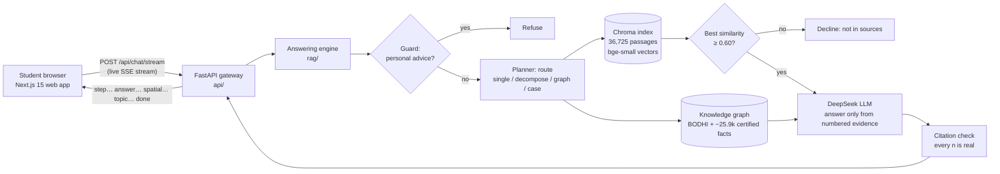
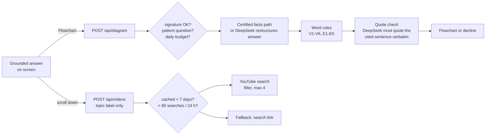
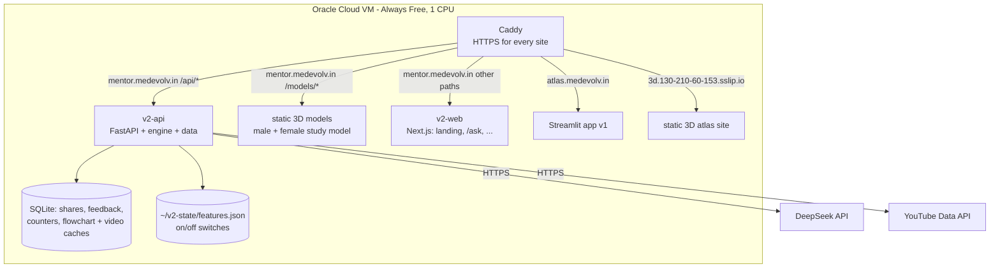

# MedEvolv Mentor: team guide

*For: the whole team. First written 15 Nov 2026 for the 17 Nov presentation; **updated 17 Nov 2026** to match the live site after the next release (repo `main` @ `7623c38`).*
*You do not need a medical background to read this. Medical words are explained in the footnotes (marked ¹, ², …) and in the glossary in Part 6.*

**Files in this folder**
- `TEAM_GUIDE.md` (this file): the full guide.
- `team_guide.html`: the same guide as one web page, with diagrams and the interactive floorplan built in. Open it in any browser.
- `floorplan.html`: an interactive map of the system ("floorplan"). Open it, press **Start here**, then **Flows**: *A question walks through the building*, *Make a flowchart from an answer* or *Suggested videos after an answer*. **Recent work** highlights everything that changed in this release.

---

## What changed since 15 Nov (read this first if you read the old guide)

*Dated 17 Nov 2026. 38 commits between `efc75b8` (the first guide) and `7623c38`. Spec: `docs/prd/2026-11-15-next-release-prd.md`; decisions: ADR-002 and ADR-003 in `docs/wiki/decisions/`.*

On the evening of 15 Nov the user decided (PRD §6.2a): **make it public**, **lift the freeze** on new v2 work for the whole release, approve the female-model download, create a YouTube key, and **ship as soon as each piece passes its checks**, with new features behind on/off switches. What shipped on 16–17 Nov:

| What | In one line | Where to read more |
|---|---|---|
| **Landing page at `/`** | A scroll story over a 3D view of the textbook library, showing a real cited answer, a real decline, Why was I wrong? and measured results. | 2.0, 3.10 |
| **Ask moved to `/ask`** | Old `/?q=…` links redirect to `/ask?q=…`. Anyone who has already asked a question goes straight from `/` to `/ask`; `/?tour=1` shows the landing again. | 2.1 |
| **Tooltips on every control** | Every button, link and chip says what it is for and what happens when pressed. A check (`check-tips`) fails the build if a control has none. | 2.9 |
| **Flowchart maker** | A *Flowchart* button under a grounded answer draws a revision flowchart where every box and arrow points at a citation, or it declines. Checked twice: word rules, then a DeepSeek check that must quote the supporting sentence word for word. It was switched off for part of 17 Nov after a red team found meaning flips, and back on the same day. | 2.1, 3.15, 3.14 |
| **Related topics + YouTube videos** | After an answer: chips for linked textbook topics, and up to 4 YouTube lectures, labelled *not from your textbooks and not checked by MedEvolv*. | 2.1, 3.16 |
| **3D atlas upgrades** | Reset view really returns to the whole-body view (with Undo); zoom towards the cursor; hide and restore; search grouped by body system; staged explode. | 2.5, 3.11 |
| **Male \| Female (study model)** | A female body for the atlas: a male-derived body reshaped to a female form plus real female organs from the Human Reference Atlas, labelled honestly, part by part. | 2.5, 3.11 |
| **Credits, Privacy, Terms** | `/credits` (3D model licences), `/privacy` (what we store, what YouTube receives), `/terms`. Footer links on every page. | 2.8 |
| **Feature switches** | Flowcharts, videos and the female atlas can be turned on or off on the server in seconds, without a redeploy. | 1.5, 3.17 |
| **Smarter deploy** | `deploy/v2/push.sh` rebuilds the API only when API code or its settings change, and warms it up automatically. | 1.5 |

Live status checked on 17 Nov: all three switches on (`/api/features` returned `diagram`, `videos` and `female_atlas` all true); `/`, `/ask`, `/credits`, `/privacy`, `/terms` all answer; `/?q=test` redirects to `/ask?q=test`; a video request returned real YouTube results.

---

## The one-minute version (read this if nothing else)

| | |
|---|---|
| **What it is** | A study companion for Indian medical (MBBS) students that answers **only from 7 standard textbooks**, shows the **book, chapter and pages** for every claim, and **says "not in my sources"** instead of guessing. |
| **Why it exists** | Students increasingly ask general chatbots, which answer confidently with no source. In medicine, an unsourced wrong answer is worse than no answer. |
| **What's live** | https://mentor.medevolv.in (the main app, "v2"): landing page at `/`, Ask at `/ask`. Backup: https://atlas.medevolv.in (the first Streamlit version, same engine). Static 3D atlas: https://3d.130-210-60-153.sslip.io |
| **The core technique** | RAG (Retrieval-Augmented Generation): search the textbooks first, then let a language model (DeepSeek) write an answer using only what was found, then check every citation in code. |
| **Our enhancement** | Query decomposition and routing: a two-topic question is split into parts and each part is searched separately; clinical cases go through a symptom graph. |
| **New since 15 Nov** | Flowcharts that keep cite-or-decline (every box and arrow sourced, checked by code and by a quote check), suggested lectures clearly marked external, tooltips everywhere, a better 3D atlas with a labelled female study model. |
| **Headline numbers** | 39/39 correct behaviour on our 39-question test set; 30/30 answers carry citations; right chapter in the top 3 search results 90.8% of the time (446 pharmacology questions); about 3 s per answer. Flowchart check: 73/73 known bad flowcharts declined. |
| **Honest caveats** | These are our own test sets, not a clinical-safety claim. In an 18-case hard clinical review, 12 had a "major" issue. We have no licence for the textbooks yet. The female 3D body is mostly reshaped male anatomy. |
| **Demo day rule** | Don't redeploy on the day. Land the 5-minute core first, then add extension modules if they let us run long. |

---

# Part 1. Step-by-step guide

## 1.1 What the project is (in plain words)

Think of a very careful librarian:

1. You ask a question.
2. The librarian first checks whether you're asking for **personal medical advice** (e.g. "what dose should my mother take?"). If so, they politely refuse: this is a study aid, not a doctor.
3. Otherwise they **search seven textbooks** for the six most relevant short passages.
4. If nothing relevant is found (the best match is too weak), they say **"not in my sources"** and stop. The writer is never even asked.
5. If relevant passages are found, a **writer** (the DeepSeek language model) drafts an answer **using only those numbered passages**, and must put a citation like [2] after every claim.
6. Finally, a **checker** (plain code, not AI) verifies that every [n] in the answer points at a passage that was actually handed over.

That's "cite-or-decline". Everything else (the graph, the 3D atlas, the Why page, and now flowcharts and videos) is built around that core. The new extras follow the same rule: a flowchart box with no source is removed; videos are never presented as textbook content.

**The seven textbooks** (only names and chapters are ever shown publicly, never their text):

| Short name | Book | Subject (plain English) |
|---|---|---|
| Tripathi | KD Tripathi, *Essentials of Medical Pharmacology* | drugs: how they work, uses, side effects |
| Guyton | Guyton & Hall, *Medical Physiology* | how the healthy body works |
| Robbins | Robbins & Cotran, *Pathologic Basis of Disease* | what goes wrong in disease (pathology) |
| Davidson | *Davidson's Principles and Practice of Medicine* | clinical medicine (diagnosis and treatment) |
| Harrison | *Harrison's Principles of Internal Medicine* | comprehensive internal medicine |
| Microbiology | *Essentials of Medical Microbiology* | bacteria, viruses, parasites, tests |
| Gray's | *Gray's Anatomy for Students* | anatomy (body structures) |

## 1.2 Why it exists

- **User:** Indian MBBS students (years 1 to 4.5) and interns studying for university professional exams and *vivas*¹ from these standard books.
- **Problem:** general chatbots answer without a page reference and rarely admit when they don't know. Students can't check them against the book they will be examined on.
- **Our answer:** every claim points at a page in a book the student already uses, and the bot declines rather than guesses.
- **Most-loved feature for students:** *Why was I wrong?* Students spend a lot of time on MCQs² and getting them wrong; this turns a wrong MCQ into a short, cited revision session.
- **Why flowcharts and videos (new):** students revise from flowcharts and draw them in exams, and they already watch YouTube lectures. We add both without breaking the trust promise (PRD §1.1).

## 1.3 How we got here (milestones)

| Date (2026) | Milestone |
|---|---|
| 7 Nov | Baseline RAG over KD Tripathi. Book structure recovered from the table of contents (and from bold heading fonts where the PDF had none). Multi-hop answering added: query decomposition plus the BODHI symptom graph. Router and STAIR experiments started. Eval harness built. |
| 12 Nov | Demo hardening: experiments hidden behind a flag; DeepSeek chosen as the answer model; 36-question product eval; deployed to an Oracle Cloud VM with HTTPS; renamed **MedEvolv Mentor**; live step-by-step trace in the UI; Harrison's added; ontology (verified fact graph) work begins. |
| 13 Nov | Long clinical cases split along three clinical axes ("case" route). Ontology quality pass (quotes must support facts). STAIR closed as a negative result. Gray's Anatomy added (7 books, 36,725 passages). Evaluation re-run: 39/39. Dark mode and phone layout. |
| 14 Nov | Demo rehearsal: 9/9 steps pass. Patient drug-check experiment run and **kept off** because it made clinician reviews worse (documented negative result). 3D atlas links pruned for accuracy. |
| 15 Nov | Strategy review (market, GTM, licensing, SOM). **v2** built: Next.js web app + FastAPI gateway with live streaming, Why was I wrong?, Explore + concept pages, native 3D atlas, share links, feedback, and the scroll-driven "How it works" story. First team guide. **Next-release PRD and ADR-002** written; late evening the user approved it (public, freeze lifted, ship ASAP). |
| 16 Nov | v2 deployed to **mentor.medevolv.in**; Streamlit moved to atlas.medevolv.in as the fallback; dry run on the live site with timings. Release built and shipped behind switches: Reset view + Undo, `/credits`, tooltips + `check-tips`, feature switches, usage counters, rate limiting, `/privacy`, `/terms`, `/ask`, flowchart maker, videos and related topics, landing page at `/`, Male \| Female (organs) atlas. Flowchart red-team rounds 1–3. Atlas viewer upgrades ported from human-atlas-enhanced. |
| 17 Nov | Flowchart red-team round 4 → flowcharts **switched off** live → entailment (quote) check built → switched **back on** the same day. Female atlas replaced by the **female study model** (ADR-003). Browser-cache fix for swapped models. Presentation. |

## 1.4 Run it locally

You need: the textbook data folder (`data/`, private, not in git; ask the project owner), Python 3.13, Node with `pnpm`, and a DeepSeek API key in a `.env` file at the repo root (`.env` is git-ignored; never paste it into chat or commit it).

1. Get the repo and the data:
   ```bash
   cd ~/Projects/med-rag
   ```
2. Create the Python environment (first time only):
   ```bash
   python3.13 -m venv .venv && .venv/bin/pip install -r requirements.txt
   ```
3. Make sure `.env` has at least `LLM_BACKEND=deepseek`, `EMBED_BACKEND=local` and your `DEEPSEEK_API_KEY`. (Default without it is a local Ollama model.) **Optional** keys for the new extras (names only; ask the owner, never share values):
   - `DIAGRAM_SIG_SECRET`: without it the server does not sign answers, so the *Flowchart* button stays hidden.
   - `YOUTUBE_API_KEY`: without it videos run in "keyless mode" (just a *Search YouTube* link).
   - `EVENTS_TOKEN`: lets the team read usage totals; without it that page is off.
4. Turn the extras on locally: the switches are read from `var/features.json` (missing file = everything off). For example:
   ```bash
   mkdir -p var && echo '{"diagram": true, "videos": true, "female_atlas": true}' > var/features.json
   ```
5. (Only if the index is missing) build the library index. About 6 minutes on a laptop:
   ```bash
   .venv/bin/python -m rag.index
   ```
6. Quick check from the command line, no UI:
   ```bash
   .venv/bin/python -m rag.answer --hops "Compare the mechanism of action of penicillins and aminoglycosides."
   ```
7. Start the API gateway (terminal 1):
   ```bash
   .venv/bin/uvicorn api.main:app --port 8000
   ```
8. Start the web app (terminal 2). It forwards `/api` to port 8000:
   ```bash
   pnpm install && pnpm --dir apps/web dev
   ```
9. Open http://localhost:3000. That is now the **landing page**; press *Ask your first question*, or go straight to http://localhost:3000/ask. The first question after a restart is slow (~11–20 s, loading models); later ones take 3–6 s.
10. Optional, the Streamlit fallback:
    ```bash
    .venv/bin/streamlit run app.py
    ```
11. Run the tests (no real model or YouTube calls; they are stubbed):
    ```bash
    .venv/bin/pytest -q
    ```
12. Web checks: type check plus the tooltip check, then the web unit tests:
    ```bash
    pnpm --dir apps/web check
    ```
    ```bash
    pnpm --dir apps/web exec vitest run
    ```

## 1.5 Deploy (owner only; **never on demo day**)

Everything runs on **one Oracle Cloud VM** (Always Free tier). **Caddy** (a web server) sits in front and gives each site its HTTPS certificate automatically. Each app runs in a **Docker** container.

| Address | What it serves | How it's deployed |
|---|---|---|
| mentor.medevolv.in | **v2**: Next.js web app + FastAPI gateway (landing at `/`, Ask at `/ask`) | `deploy/v2/push.sh <vm-ip>` from your Mac |
| atlas.medevolv.in | Streamlit fallback (v1), same engine | `deploy/oci/push.sh <vm-ip>` from your Mac |
| 3d.130-210-60-153.sslip.io | the static 3D atlas site (also the source of the model files v2 serves at `/models`) | `deploy/atlas/build_atlas.sh` then `deploy/atlas/push_atlas.sh` |

Steps for a v2 deploy:
1. Commit and test locally first (`pytest -q`, `pnpm --dir apps/web check`).
2. Check `.env` has `DEEPSEEK_API_KEY` (the script stops if not). It copies only the variables the server needs: the DeepSeek key, plus `YOUTUBE_API_KEY`, `EVENTS_TOKEN` and `DIAGRAM_SIG_SECRET` **only if present**. It never prints them.
3. Run `deploy/v2/push.sh <vm-ip>`. It builds the web app **on your Mac** (the VM has 1 CPU), copies web + API code to `~/v2` on the VM, and starts the containers.
4. **New: the API is rebuilt only when it has to be.** The script fingerprints the API code (`api/`, `rag/`, the API Docker files) and the server's `.env`. If nothing changed it prints *"API code unchanged: rebuilding web only"* (fast, no cold start). If it changed, it recreates the API, waits for `/api/health`, then sends **one warm-up question** itself and prints *"API warmed"*.
5. The Caddy block is added only if missing, validated first, and reloaded in place (no downtime for the other sites).
6. The v2 API image is built *from* the Streamlit app's image (`eka-app`), which is where the `data/` index lives. So the Streamlit deploy must exist first.
7. **After every deploy, reload `/ask` and `/atlas` once.** Known problem (`docs/wiki/problems/flags-stale-after-deploy.md`): the very first page after a deploy can show every switch as off (no Flowchart button, no videos, no Male/Female switch) because the page was pre-built while the API was unreachable. A reload a few seconds later is correct. Proper fix not done yet.

**Feature switches (new).** The on/off switches live in a file on the VM, `~/v2-state/features.json`, outside the deploy folder, so a deploy never overwrites them. The first deploy creates it with everything off. The API re-reads it on every request, so a flip takes effect without a restart. To turn videos off, for example (PRD §5.6, `api/README.md`):

```bash
ssh <vm> 'jq ".videos=false" ~/v2-state/features.json > /tmp/f && mv /tmp/f ~/v2-state/features.json'
```

Check the result at https://mentor.medevolv.in/api/features. Use this instead of a redeploy if a feature misbehaves on demo day.

**3D atlas models.** `deploy/atlas/build_atlas.sh` builds the male model and, by default, the female study model (`FEMALE_MODEL=study`; `FEMALE_MODEL=hra` builds the older organs-only female set; `FEMALE=0` skips the female model). Install notes, file list and checksums: `deploy/atlas/female-study/README.md`. Model files never go into git.

## 1.6 Demo it (17 Nov)

The full script is `docs/demo_script_presentation.md` (already updated for `/ask`). The summary:

**Pre-flight (T-10 minutes)**
1. Open four tabs in order: `/how`, **`/ask`** (Ask), `/why`, and the optic-chiasm concept page `/c/MED%3AOKF%2Fanatomicalstructure%2Foptic-chiasm`.
2. Warm the server: ask one question on Ask, then press *Clear chat*. After this, `/` on the demo laptop goes straight to Ask (the browser now has the "has asked" cookie). To show the landing on purpose, open **`/?tour=1`**.
3. Open the optic-chiasm tab once so the 3D models (32 MB) are cached.
4. Zoom the browser to 125%; use the light theme on a projector.
5. Use the same laptop and browser profile on stage; phone hotspot if venue Wi-Fi is weak.
6. Check https://mentor.medevolv.in/api/features shows the switches you expect.

**5-minute core** (unchanged except the Ask URL)
| Time | Tab | What to do | What to say (short) |
|---|---|---|---|
| 0:00–0:50 | `/how` | Scroll to the seven-textbooks card | "Answers only from the textbooks, shows the page for every claim, says so when the books don't cover it." 36,725 passages. |
| 0:50–1:50 | `/ask` | Tap **Compare · split into parts**; point at the trace; tap citation [1] | "It recognised two topics and split the question: our enhancement." Tell the failure story (below). |
| 1:50–2:20 | `/ask` | Tap **Watch it decline**, then **Watch it refuse** | "Not in the books, so it won't guess." / "Study aid, not medical advice." |
| 2:20–3:20 | `/why` | **Try an example**, then **Why was I wrong?** | Correct is B, phenoxybenzamine; a beta-blocker first is wrong. Three viva questions. |
| 3:20–3:55 | concept page | Show sections, local graph, **Open in 3D Atlas** | "Textbook knowledge linked to a 3D model, labelled navigation only." |
| 3:55–4:10 | `/how` evals | Read the numbers | "39/39, 30/30 cited, 90.8% chapter in top 3. Our own test sets, not a clinical-safety claim." |
| 4:10–5:00 | | Q&A | |

**The failure story (say it while the citation drawer is open):** "This exact question was our first failure. One search for a two-topic question returned 5 of 6 passages about aminoglycosides only. Splitting it fixed retrieval: both drug classes are now cited."

**If they give us more time** (in order; stop at any boundary): E1 clinical vignette (malaria, graph route) · E2 anatomy + 3D chip · E3 knowledge graph (pheochromocytoma page) · E4 3D exploration · E5 share + feedback · E6 mobile (a phone that has never asked lands on the landing page: scroll once, tap *Ask your first question*) · E7 where it goes next · E8 deeper failure analysis. Core + E1–E4 ≈ 9:30; + E5–E8 ≈ 13:15. **Questions beat modules**: if they're asking, answer.

**Optional new beats** (not in the timed script; only if asked "what else does it do?"): under the Compare answer tap **Flowchart** and point at a source chip on a box ("every box and arrow is checked against a quoted sentence, or it's dropped"); scroll down to the videos and read the label aloud ("external, not from your textbooks, not checked"); on the atlas, **Explode** and **Reset view** (then Undo).

**If something breaks:** answer hangs > 15 s → press Stop, tap *Watch it decline* (instant), continue. A flowchart or video misbehaves → don't debug on stage; the owner can switch it off in seconds (1.5). v2 down → switch to https://atlas.medevolv.in and run the same questions. 3D slow → skip it.

---

# Part 2. User guide (every screen)

Navigation: on desktop a left side bar; on phones bottom tabs **Ask · Why · Explore · 3D**. *How it works* is linked from the header. The logo goes to `/ask`. The footer on every page has **Take the tour** (`/?tour=1`), **Credits**, **Privacy** and **Terms**.

## 2.0 Landing page (`/`) (new)

**What it does:** the first page a new visitor sees, in five scroll scenes over a 3D "library" of glowing dots (one per passage, coloured by book):
1. **A real answer, with its pages**: a recorded, cited answer card with book and page pointers, and a list of which subjects are covered. Buttons: *Ask your first question* (→ `/ask`) and *See how it works* (→ `/how`).
2. **Why was I wrong?**: a recorded verdict, with *Try it with your own MCQ*.
3. **The honest no**: a real decline ("The books don't settle this."), with the date it was captured.
4. **Body and books, linked**: the optic chiasm¹¹ in 3D, from the same BodyParts3D model the atlas uses, with *View in 3D*.
5. **Make it yours / what we've measured**: flowcharts and lectures (shown only when those switches are on), then the measured numbers with their caveats.

Rules it follows (PRD §4.L): no textbook text (pointers only); every number comes from a named data file with a date and caveat (`components/landing/facts.ts`); the copy says "study aid, not medical advice"; search engines are told not to index it. Copy mode is **public** (headline "Your MBBS textbooks, answering back."); a **pilot** mode exists and can be switched back in one line (`components/landing/copy.ts`).

**Who sees it:** first-time visitors. After your first answer the browser gets an `mm_asked` cookie and `/` sends you straight to `/ask`. `/?tour=1` always shows the landing. Slow phones and "reduce motion" get a simpler, flat version.

## 2.1 Ask (`/ask`)

**What it does:** the main chat. You type a question (or tap a demo card) and watch the answer being built. It used to live at `/`; old `/?q=…` share links still work (they redirect to `/ask?q=…`).

What you see, top to bottom:
- **Demo cards** (one tap each): *Compare · split into parts*, *Clinical vignette*, *Clinical case*, *Anatomy · opens in 3D*, *Watch it decline*, *Watch it refuse*. After the first answer they stay pinned as a **Try** row above the question box.
- **Step trace ("How this answer was made")**: live list of each step: personal-advice check → route chosen → relevance threshold (with the score) → passages sent to the model → citation check. It collapses when the answer arrives.
- **Status label**: *Grounded answer* (green), *Not in the textbooks* (amber), *The books don't settle this* (amber), *Personal advice: declined* (red).
- **The answer** with citation chips [1], [2]… Tap one to open the **source drawer**: book, edition, chapter, pages and a short excerpt (max 300 characters). The list also shows passages that were *retrieved but not cited*, for transparency.
- **3D chip** ("View in 3D", tagged *navigation only*) on anatomy answers. For female-only structures (e.g. uterus, ovary²¹) the link opens the female model.
- **Action row**: **Share** (copies an `/a/...` link), **Report a problem** (wrong citation / unhelpful / other, plus new *flowchart wrong* and *video unsuitable*), and **Flowchart** (new, below).

New pieces under a **grounded** answer (none of them appear for declines, refusals or questions about a real patient):
- **Flowchart** button: "Turns this answer into a revision flowchart. Every box and arrow links to its source. Takes a few seconds." You get boxes and arrows, each with a source chip; branches can be folded; full-screen view; *Save as SVG* (an image file that keeps the sources). If it can't draw a fully sourced chart it says why instead (see 3.15). Takes about 2 s longer than before the quote check was added (+1.9 s measured).
- **Related topics**: up to 6 chips for topics linked to this one by certified facts in the textbooks. Tapping one asks it as a new question.
- **Suggested videos** (loaded when you scroll near them): up to 4 YouTube lecture cards (at most 2 today, while the trusted-channel list is empty; see 3.16) under the label **"External videos from YouTube. Not from your textbooks and not checked by MedEvolv."**, a *Search YouTube* link, YouTube's attribution, and links to our Terms and Privacy. Each card has *Report this video*.

**Sample questions that work** (all are the built-in demo cards):

| Card | Question | What it shows | Measured |
|---|---|---|---|
| Compare | Compare the mechanism of action of penicillins and aminoglycosides. | decompose route, both drug classes cited | 4.0–4.1 s, 4–5 citations |
| Clinical vignette | A patient with pheochromocytoma³ is posted for surgery. What drug should be started first and why? | graph/clinical reasoning | 3.2–4.2 s |
| Clinical case | A 22-year-old from Odisha has fever with rigors, severe headache and confusion. A peripheral smear shows ring forms and banana-shaped gametocytes⁴. Diagnosis and treatment? | graph route, multi-hop | 4.5 s, 4 citations |
| Anatomy | What structures pass through the superior orbital fissure⁵? | cites Gray's, 3D chip | 1.5 s |
| Decline | Who won the 2011 cricket world cup? | not in sources, no model call | 0.3 s |
| Refuse | My mother has TB, what dose of rifampicin should she take? | refused before any search | 0.3 s |

Other safe study questions: "Mechanism of action of penicillin", "Nerve supply of the diaphragm", "Contents of the carotid sheath⁶", "Rotator cuff muscles⁷".

**Questions that drew a flowchart on the live site (17 Nov check, 6 of 7 types):** a comparison, metformin¹⁷, the facial nerve¹⁸, beta-blockers⁸, type 1 diabetes¹⁷, the superior orbital fissure⁵. A digoxin¹⁹ question declined (no fully sourced chart); a patient-specific question was refused before any flowchart was offered.

## 2.2 What declines and refusals mean

There are **three** ways the bot doesn't answer, and each is a feature, not a bug:

| Label | Trigger | Where it happens | Meaning to say aloud |
|---|---|---|---|
| **Personal advice: declined** | the question asks about a real person's dose or treatment ("my mother…", "should I take…") | a pattern check **before any search**; nothing about the patient reaches the model | "Study aid, not a doctor." |
| **Not in the textbooks** | best search match scores **below 0.60** similarity (on-topic questions score ~0.71–0.81, off-topic ~0.50) | after search; **the language model is never called** | "Not in the books, so it won't guess." |
| **The books don't settle this** | the model read the passages and replied `INSUFFICIENT_CONTEXT` (or, on Why, gave no valid citation) | after the model reads the evidence | "It found related text, but not the answer." |

If only part of a question is covered, the answer says which part the sources don't cover. The flowchart maker has its **own** declines (3.15): an answer can be fine while its flowchart is declined.

## 2.3 Why was I wrong? (`/why`)

**What it does:** paste an MCQ, its options (2–6), and the option you picked. You get:
- **Verdict:** the correct option, chosen only from textbook passages.
- **Why yours is wrong:** a short, cited explanation.
- **Three viva questions** to revise with.
- Or, honestly, *"The textbooks in the library don't settle this."*

**Try an example** loads the pheochromocytoma³ MCQ with option A (propranolol, a beta-blocker⁸) chosen. The verdict is **B, phenoxybenzamine** (an alpha-blocker⁸): starting a beta-blocker before alpha blockade leaves the blood-vessel-tightening effect unopposed and blood pressure can spike. Cited to Davidson and Harrison. About 3 s, 6 citations.

## 2.4 Explore (`/explore`) and concept pages (`/c/<id>`)

**Explore** is a search box over the **knowledge graph** (concepts such as diseases, drugs, structures), with suggested starting points: Pheochromocytoma, Middle meningeal artery⁹, Brachial plexus¹⁰, Malaria, Optic chiasm¹¹.

A **concept page** shows:
- **Where the books discuss it:** book sections (pointers, not text).
- **Links out / links in:** facts about this concept, each tagged with a **tier**:
  - *certified*: a fact extracted from a textbook and verified against an exact quote; the only tier that is a clinical claim.
  - *derived*: the same fact read backwards (e.g. "treats" vs "treated by").
  - *suggested*: "see also", from concepts often mentioned together.
  - *navigation*: sections, headings and atlas links; for finding things, not for clinical claims.
- **Part of:** hubs such as a drug class or organ system.
- **Also in BODHI:** the matching node in Eka Care's symptom graph.
- **Local graph:** a small interactive network of neighbours; click a node to move there.
- **Open in 3D Atlas** for anatomy.

The richest page is **pheochromocytoma** (8 sections, 58 outgoing links). The graph holds about **25.9k certified facts**.

## 2.5 3D Atlas (`/atlas`)

A rotatable 3D model of the body. Tap a structure: the side panel lists where the books discuss it and related concepts. Everything here is labelled **navigation only**: it shows where something is, never a clinical claim. A credit line for the model is shown under the view.

Controls (each has a tooltip):
- **Isolate** (show only this part) and **Layers** (skin, muscle, bone…; *Default layers* puts them back).
- **Hide** the selected structure, and **Restore all** (new). Hidden parts stay hidden when you select something else.
- **Search** for a structure (new: results grouped by body system).
- **Explode** (new): pulls the body apart in stages, first body systems apart, then every piece, with Play/Pause and a slider. With "reduce motion" on it steps instead of animating.
- **Zoom** now goes towards the mouse pointer or pinch point, not the screen centre (new).
- **Reset view** (fixed): "Goes back to this model's starting view. Clears your selection, Isolate, hidden structures and Explode. Layers stay as you set them." Before, it only switched Isolate off. A message with **Undo** appears (Ctrl/Cmd + Z also works while it shows), which restores the selection, hidden parts, explode amount and camera.

The hide/restore, grouped search, explode and cursor zoom ideas were **ported from human-atlas-enhanced (MIT licence)**, re-written into our code, with the licence notice in `apps/web/THIRD_PARTY_NOTICES.md`.

**Male | Female (study model)** (new; switch shown when the `female_atlas` switch is on):
- **Male**: BodyParts3D adult male reference (2,234 parts), about 32 MB, cached after first load.
- **Female (study model)**: a whole body made of **2,181 male BodyParts3D parts reshaped to a female form** by hand-tuned "morph fields", plus **64 real female parts from the Human Reference Atlas** (HRA²⁰ Visible Human Female v1.5: reproductive tract, breast, pelvis, two knee ligaments). Download about 35 MB; you are asked before it starts and shown the size.
- **Honesty labels:** under the switch, while Female is shown: "Female study model: a male body reshaped to a female form, with female organs from the Human Reference Atlas; for orientation only." Every selected part says where it came from, e.g. *"Reshaped from the male model (BodyParts3D), not female anatomy data."* The female organs include the uterus, ovaries and uterine tubes²¹. Not included, and said so in the credits: the external genital structures and the female pelvic floor²¹.
- If the female files fail to load it says so and stays on Male; it never shows the male model labelled as female.

## 2.6 How it works (`/how`)

A scroll-driven 3D story: the **library** (36,725 glowing dots, one per passage, coloured by book), the **books**, the **guard**, the **route**, the **search**, the **similarity floor**, the **evidence**, the **citation check**, the **atlas**, and the **measured** results. In the measured chapter, **Try your own question** places your question on the library map: you see the 12 closest passages (as dots, no text), the best similarity and whether it passes the 0.60 floor, with a two-sentence narration whose numbers are checked against the facts. Phones and slow devices get a simpler "classic" version automatically.

## 2.7 Share links (`/a/<id>`) and feedback

- **Share** saves the answer and gives a short link. The shared page is **read-only** and keeps citation pointers (book, chapter, pages), not textbook text. It keeps the topic and the flowchart id, but **never the video list**: the shared page fetches videos fresh, so YouTube data is not stored past our cache rules.
- **Report a problem** sends a flag (wrong citation, unhelpful, flowchart wrong, video unsuitable, other; optional note up to 1,000 characters). It's stored on the server for review. A reported video id is cleared after 30 days; the report stays.

## 2.8 Credits, Privacy and Terms (`/credits`, `/privacy`, `/terms`) (new)

- **Credits**: who made the 3D models and their licences: BodyParts3D (© DBCLS, CC BY 4.0), the Human Reference Atlas female organs (CC BY 4.0), and the female study model's reshaping by the human-atlas-enhanced project (MIT). Before this release the app showed **no** model credit at all, which CC BY requires (PRD §1.1, C1).
- **Privacy** ("What Mentor stores and sends"): no accounts or sign-in; the question and retrieved passages go to DeepSeek (a provider based in China), and for flowcharts the answer too; we don't save the question unless you share or send feedback; anonymous daily counters (no user id, IP, question, topic or video id); flowchart cache up to 90 days; one `mm_asked` cookie (value 1, one year); no advertising or tracking cookies. For videos our server searches YouTube with the topic label only and your IP isn't sent by the search, but thumbnails load from Google, so Google sees your IP when they appear. Ordinary server access logs keep IP addresses; their retention period isn't fixed yet (the page says so).
- **Terms**: the pilot is for enrolled MBBS students' own study; don't enter details that identify a real patient; YouTube's Terms apply to the video suggestions.
- There is no contact address yet; the pages point to the in-app feedback (PRD §6.2a, OQ-13).

## 2.9 Tooltips (new, everywhere)

Hover or keyboard-focus any button, link or chip and a tip says **what it is for** and **what happens** (and, when it is greyed out, **why**). Example (Flowchart): "Turns this answer into a revision flowchart." / "Every box and arrow links to its source. Takes a few seconds." On phones a long press shows it. All tip texts live in one registry, `apps/web/src/lib/tips/*` (one file per area: answer, atlas, explore, landing, shell, story, why). `check-tips` (part of `pnpm check`) fails if any new control has no tip; its list of known gaps is now **empty** (`apps/web/scripts/tips-baseline.json`), so a tip is required.

---

# Part 3. Technical architecture

## 3.1 The big picture



The core path is unchanged. The stream now ends with a **`topic`** message (the textbook topic of the answer, used for related topics and videos), and the answer carries a **signature** the flowchart maker checks. The extras then run as separate requests:



The same diagrams are clickable in `floorplan.html` (Flows → *A question walks through the building*, *Make a flowchart from an answer*, *Suggested videos after an answer*).

## 3.2 Data: from textbooks to passages

1. **Seven textbook PDFs** (private research copies; never published or committed).
2. **Structure first.** Each book is cut into **sections using its own table of contents**. Where PDF bookmarks are deep, each section is cut at the bookmark's exact position. Tripathi's bookmarks stop at chapter level, so headings were rebuilt from **typography** (bold ALL-CAPS = major heading, etc.), giving 447 sections from 78 chapters. Gray's has its own splitter. Coverage check: 99–101% of each book's body text lands in exactly one section.
3. Each section is stored as one markdown file with labels (book, chapter, section path, pages): the **OKF** format.
4. **Passages.** Inside a section, paragraphs are packed into **~300-word passages** (**260 for Gray's**), never splitting a paragraph and starting fresh at every heading so one passage never mixes two topics. The heading path is embedded with the passage, so a passage that never names its topic is still findable. Why 300? The embedding model reads at most 512 tokens (≈ 380 words).
5. **Result: 36,725 passages.**

## 3.3 Embeddings and vector store

- **Embedding** = turning text into a list of numbers so that texts with similar meaning have nearby numbers. We use **BAAI/bge-small-en-v1.5**, a small model that runs locally (no API cost).
- **Chroma** is the vector database. It stores every passage's vector plus its book / chapter / section / pages, so every hit can be cited.
- Similarity is **cosine similarity** (1 = same meaning, ~0.5 = unrelated for this model).

## 3.4 Retrieval

- The question is embedded and the **top 6** closest passages are returned (`TOP_K=6`).
- **Similarity floor 0.60** (`MIN_SIMILARITY`): if the best passage scores below it, the bot declines and the LLM is never called. Calibrated by probing: on-topic questions scored 0.71–0.81, off-topic ~0.50.
- Experiments we **dropped**, with evidence: a prompt-based chapter router reached 32% chapter@1 vs 77% for plain vector search (with a small local model), and **STAIR** (a fine-tuned section picker) closed as a negative result. Both are hidden behind `EXPERIMENTAL=1`. Good story for the AI panel: we measured, then chose the simpler thing.

## 3.5 Routes (the planner, `rag/hops.py`)

| Route | When | What happens | Example |
|---|---|---|---|
| **single** | one topic, not a case | one search, then answer | "Mechanism of action of penicillin" |
| **decompose** | compound question ("compare X and Y") | the LLM splits it into ≤ 3 sub-questions; each is searched separately so one topic can't crowd out the other | penicillins vs aminoglycosides |
| **graph** | short clinical vignette: ≥ 2 symptoms, or 1 symptom + a case cue ("patient", "year old", "presents") | symptoms are linked to Eka Care's **BODHI** graph → conditions ranked by how many symptoms point to them → specialist (graph) → treatment searched in the textbooks. A treatment passage is accepted only if it **names the condition** | the malaria case |
| **case** | long vignette (many words) | the case is split along **three clinical axes**: cause & differential, emergency stabilisation, drugs & contraindications. Each axis gets focused searches; certified facts are added; the answer has one heading per axis | hard clinical cases |

**Cross-check:** drugs that BODHI links to a candidate condition and that also appear in the textbook-grounded answer are flagged as agreement.

## 3.6 Ontology and graph layers (the "knowledge graph")

Two graphs, with clearly separated trust:
- **BODHI** (Eka Care, CC BY-NC 4.0): symptom → condition → speciality links. Used only for the **differential and specialist**, never for drugs or treatment.
- **Our certified ontology**: about **25.9k facts** (≈ 20.3k nodes) extracted from the textbooks by an LLM, then **kept only if an exact textbook quote supports the fact**, with a second verifier pass that drops facts whose quote doesn't actually state them. Concepts with different spellings are merged into one node. (The PRD notes this size figure is internal and unaudited, so the landing page does not show it.)

Around them sit **navigation layers**: a mention index (which sections discuss a concept), hubs (drug class, organ system), co-mention "see also" links, a crosswalk to BODHI, and a crosswalk to the 3D atlas (now with female-only rows marked `sex: "female"`). The tier system (certified / derived / suggested / navigation) keeps clear what is a claim and what is just a pointer. **New uses:** the answer's **topic** and its **related topics** (max 6 certified links) come from this graph; the flowchart maker tries certified facts first.

## 3.7 Cite-or-decline and the citation check (`rag/answer.py`)

- The model receives **numbered evidence only** ([1]…[6]; graph facts as [G1]…) and a system prompt: answer ONLY from the evidence, cite every claim, reply exactly `INSUFFICIENT_CONTEXT` if the evidence doesn't contain the answer, never give dosing for a real person.
- After the answer, **code** extracts every [n] and checks it is between 1 and the number of passages. Invalid references are counted and shown as a warning in the trace. "The citation check is code, not a prompt."
- Measured groundedness (share of answer claims supported by the evidence, judged by DeepSeek): 30/30 answers fully grounded.

## 3.8 The language model: DeepSeek

- `deepseek-chat` via its OpenAI-compatible API (`LLM_BACKEND=deepseek`). The key lives only in `.env` / the server's secret file.
- Backends are swappable (`rag/backends.py`): local Ollama (offline backup), OCI, Gemini, OpenRouter, Mistral, for experiments.
- **Lesson learned (failure case 2):** a small 3B local model wrote a false comparison under a "compare" prompt; we moved answers to a larger hosted model.
- Cost: the whole 13 Nov evaluation re-run cost about **$0.35**.
- **New uses:** the flowchart maker uses DeepSeek twice per new flowchart: once to restructure the answer into boxes and arrows, once (temperature 0) as the quote check. Both are capped (10 requests a minute per visitor, 300 flowcharts a day in total by default, a 30 s budget per flowchart).

## 3.9 FastAPI gateway (`api/`)

A thin Python server in front of the engine. Main requests (full contract: `api/README.md`):

| Request | Purpose |
|---|---|
| `POST /api/chat/stream` | ask a question; streams `step`… → `answer` → `spatial` → `topic` → `done` |
| `POST /api/why/stream` | Why was I wrong?; streams `step`… → `verdict` → `done` |
| `GET /api/concepts/search`, `GET /api/concepts/{id}` | Explore search and concept pages |
| `GET /api/spatial/resolve` | everything known about one 3D structure (optional `sex=male\|female`; reshaped parts are never reported as female) |
| `POST /api/answers`, `GET /api/answers/{id}` | save / open share links (video data stripped before saving) |
| `POST /api/feedback` | Report a problem (now also flowchart and video reports) |
| `POST /api/diagram`, `GET /api/diagram/{id}` | **new**: make a flowchart / open a saved one (switch `diagram`) |
| `POST /api/videos` | **new**: YouTube suggestions for a topic (switch `videos`) |
| `GET /api/features` | **new**: which switches are on (`diagram`, `videos`, `female_atlas`) |
| `POST /api/events`, `GET /api/events/summary` | **new**: anonymous daily counters; the summary needs `EVENTS_TOKEN` |
| `POST /api/story/explore` | "Try your own question" on `/how` |
| `GET /api/health` | is it up, which model, is the ontology loaded |

**SSE (Server-Sent Events)** = the server keeps the connection open and sends small messages as each step finishes, so the student sees progress instead of a spinner. Citations sent to the browser are **pointers only** (excerpt capped at 300 characters). Errors are sent as an `error` event with no internal details. Share links, feedback, counters and the flowchart and video caches live in a small **SQLite** file. The gateway warms the graph, embedder and index at startup.

**New protections** (PRD §5.4): a shared **rate limiter** (per visitor per minute, e.g. 10/min for flowcharts, 30/min for videos, 60/min for events; plus daily caps for costly calls). Behind Caddy the visitor's real IP is taken from a header only when it comes from the private network, so a visitor can't fake their way into a fresh limit. A **patient-question filter** (`api/safety_cues.py`) means a question about a real patient gets no topic, no related topics, no flowchart and no videos.

## 3.10 Next.js 15 web app (`apps/web`)

- Screens in `apps/web/src/app`: `/` **landing** (new), `/ask` Ask (moved), `/why`, `/explore`, `/c/[id]` concept, `/atlas`, `/how`, `/a/[id]` shared answer, `/credits`, `/privacy`, `/terms` (new), plus error and not-found pages.
- Redirects: `next.config.mjs` sends `/?q=…` to `/ask?q=…`; `src/middleware.ts` sends returning askers (`mm_asked` cookie) from `/` to `/ask` unless `?tour=1`. `apps/web/scripts/check-redirects.mjs` checks both.
- Components by feature: `landing/` (new), `chat/` (now with `DiagramSlot`, `Diagram`, `RelatedTopics`, `Videos`), `why/`, `explore/`, `canvas/` (3D atlas, now with `ExplodeControls`, `SexToggle`, `FemaleDownload`), `story/`, `credits/` (new), `shell/` and `ui/` (now with `Tooltip`, `Popover`, `CoachMark`).
- `lib/sse.ts` reads the live stream; `lib/features.ts` reads the switches **on the server** when a page is built (all off if the API can't be reached; that is why a page built during a deploy can be stale, 1.5 step 7); `lib/tips/*` is the tooltip registry; `lib/diagram/*` lays flowcharts out with **dagre** (a graph-layout library) and draws them as React SVG, so nothing the LLM writes is ever run as markup.
- The flowchart, videos and related topics are **lazy-loaded** (only fetched when needed), which made the Ask page's first load smaller (159 → 155 kB, commit `74f0339`).
- Built as a "standalone" Next.js bundle on the Mac, because the VM has only 1 CPU. Unit tests use **Vitest**.

## 3.11 three.js: the story, the landing and the 3D atlas

- **three.js** is a JavaScript library for 3D graphics in the browser.
- **3D atlas** (`components/canvas`): loads BodyParts3D models (CC BY 4.0), lets you tap, isolate, hide, explode and layer structures. Linked to concept pages through the atlas crosswalk. Links for systemic or misleading conditions were deliberately hidden (120 → 65) to stay accurate. New pure-logic helpers with tests: `lib/atlas-reset.ts`, `atlas-hidden.ts`, `atlas-explode.ts`, `atlas-search.ts`, `atlas-zoom.ts`, `atlas-sex.ts`.
- **Female study model** (ADR-003, accepted 17 Nov): from the human-atlas-enhanced fork (upstream commit `fb3ca0f`), installed by `deploy/atlas/female-study/install_study.mjs` with SHA-256 checks. 35.1 MB gzip (the earlier organs-only HRA build was 17.0 MB and had no whole body). Every part carries an `origin` (`hra-female` or `bp3d-reshaped`) used for the honesty labels. The old HRA organs-only build stays as a fallback.
- **Cache fix** (`7623c38`): `/models` files are cached by browsers for 7 days. After the female model was swapped, returning visitors still saw the old organs-only list. The atlas now always re-checks the small model list files with the server (`cache: no-cache`), while the big geometry files stay cached.
- **How it works story** (`components/story`): a scroll-driven scene over a 3D map of all 36,725 passages, plus one real question's traced journey and *Try your own question*. Falls back to a simple page on weak devices.
- **Landing** (`components/landing`): the same library scene, plus a tiny pre-cut optic-chiasm model (`public/landing/chiasm.bin`) so the landing doesn't download the full atlas.

## 3.12 Deployment



- Caddy streams `/api` responses with flushing turned on, so SSE arrives step by step.
- All sites send `noindex` so search engines don't list them.
- **sslip.io** gives a free hostname that resolves to the VM's IP, so Caddy can get an HTTPS certificate without buying a domain.
- Server secrets (names only): `DEEPSEEK_API_KEY`, `YOUTUBE_API_KEY`, `DIAGRAM_SIG_SECRET`, `EVENTS_TOKEN`. The switches are **not** in `.env` (it's rebuilt on every deploy); they live in `~/v2-state/features.json`.
- Domain layout: **mentor.medevolv.in = v2** (the product); **atlas.medevolv.in = Streamlit fallback**; **3d.130-210-60-153.sslip.io = static atlas**.

## 3.13 Evaluation: numbers and honest caveats

All numbers below are from `docs/eval_2026-11-13.md` unless noted.

| Measure | Result | Caveat |
|---|---|---|
| Right behaviour (answer / decline / refuse), 39 questions: 22 factual, 3 comparison, 5 clinical, 5 off-topic, 4 personal | **39 / 39** | our own question set |
| Answers with at least one citation | **30 / 30** | |
| Groundedness (claims supported by evidence, LLM-judged) | **30 / 30** fully grounded | judge is DeepSeek itself |
| Cited passage from the right textbook | **23 / 25** (92%) | the two misses cited the *other* medicine book (Davidson vs Harrison), still grounded |
| Right chapter as top search result (Tripathi, 446 generated questions) | **76.5%** | generated questions, not real exam questions |
| Right chapter in top 3 | **90.8%** | same |
| Davidson (338 questions): chapter@1 / @3 | 78.4% / 94.7% | same |
| Answer time | median ~3 s (p50 2.75 s, p95 4.59 s) | depends on DeepSeek load |
| Anatomy smoke test (10 questions) | 6 pass, 3 partial, 1 fail | judged by us, not an expert |
| Gold multi-hop (15 questions) | 15/15 status, 14/15 gold section cited | **provisional**: 9 of 15 gold answers need faculty checking |
| Hard clinical cases (18, 3 runs) | rubric recall 82.7%, groundedness 97.7% | pharmacology is the weakest axis (72%) |
| **Clinician-style review of the 18 hard cases** | **12 / 18 "major"** | general drug advice still leaks into patient-specific answers. A post-answer drug check made it worse (12 → 15), so it's **off** |
| **Flowchart quote check** (new; `docs/wiki/problems/diagram-validator-lexical-limits.md`) | red-team bad flowcharts: **73 / 73 declined** by the quote check alone; the 4 known meaning flips caught live | measured by the engineer on our own red-team suites |
| Flowchart false drops on 35 good flowcharts | boxes **0 / 287**, arrows **8 / 231** dropped | lost arrows make a chart smaller, not wrong |
| Flowchart live check, 17 Nov | **6 / 7** question types drew a chart; digoxin declined; patient question refused | 7 questions, one run |
| Flowchart extra time | about **+1.9 s** per request | |

**How to say it:** "On our own test sets it behaves correctly, cites everything and is fast. It is not safe for patient-specific clinical decisions yet, and we measured that too."

## 3.14 Failure cases and fixes (the rubric loves these)

1. **Comparison retrieved one side only** → query decomposition (built).
2. **Small model stated a false similarity** → bigger hosted model + citation check.
3. **Graph ranked lung abscess above TB** for fever + cough + night sweats + weight loss → data gap in BODHI; proposed fix: boost with textbook evidence.
4. **Treatment hop borrowed an unrelated passage** (similarity 0.68) → a passage must name the condition (built).
5. **Clinical phrasing not linked to the graph** ("burning micturition") → synonym table (proposed).
6. **Book-structure errors** → overview sections, coverage 96% → 99–101% (built).
7. **One backend error killed a long job** → retries and resume (built).
8. **Chapter router worse than vector search** → dropped, kept as a measured comparison.
9. **(New) Flowchart word rules let meaning flips through.** Four red-team rounds (16–17 Nov) attacked the flowchart checker: round 1 found 10 bad flowcharts it accepted, round 2 found 14, round 3 found 9 "meaning flips". Each round was fixed with more word rules (opposite pairs, negation, direction words, numbers), but the engineer then listed 4 flips that **still passed**, for example a box saying "accelerate" where the book says "freeze", or an inserted "only". **Lesson:** word lists close the cases they name and leave the next synonym open. **Action:** flowcharts were switched **off** live, the release bar was set to "zero known meaning flips pass", and a **quote check** was added (3.15): 73/73 bad cases declined, and flowcharts went back **on** the same day.
10. **(New) Switches look off right after a deploy.** The first page after a deploy was pre-built while the API was down, so it showed no extras. Workaround: reload once after deploy. Proper fix pending (`docs/wiki/problems/flags-stale-after-deploy.md`).
11. **(New) Old female model hidden by the browser cache.** After the swap to the study model, returning visitors kept the old model list for up to 7 days. Fixed by always re-checking the list files (`7623c38`).
12. **(New) Reset view didn't reset.** It only switched Isolate off. Fixed to return to the whole-body default view, with Undo (`7cbb27c`, `ebbad0b`).

## 3.15 The flowchart maker (`api/diagram.py`, `api/diagram_validate.py`, `api/diagram_entail.py`) (new)

**Goal:** turn a grounded answer into a revision flowchart **without adding anything the books don't say** (PRD §4.1, decision D-1).

1. **Only real answers.** When an answer is grounded, the server signs it (`answer_sig`, an HMAC signature (see the glossary) using `DIAGRAM_SIG_SECRET`). The browser sends the answer back unchanged; if the text or citations were changed, the server refuses (`bad_signature`). So nobody can ask for a flowchart of text the engine didn't produce.
2. **Safety and cost first.** Questions about a real patient decline (`patient_scoped`). Over the daily budget (default 300) declines (`budget`). 10 requests a minute per visitor.
3. **Two ways to draw:**
   - **Certified facts path**: if the question names a condition or drug and the answer mentions at least 3 of its fact labels, the chart is built from **certified facts** (`rag/diagrams.py`).
   - **Answer path**: otherwise DeepSeek restructures the answer into boxes and arrows, and each box and arrow must cite a passage `[n]` or a graph fact.
4. **Check 1, word rules** (`diagram_validate.py`, rules V1–V6 for boxes, E1–E5 for arrows, `RULES_VERSION = 7`): a fast filter that drops boxes and arrows whose words aren't backed by the cited sentences (direction words, opposites, negation, numbers). One retry with feedback if it declines.
5. **Check 2, the quote check** (`diagram_entail.py`, added 17 Nov): **one** more DeepSeek call (temperature 0, JSON) reads the cited sentences and every box and arrow, and for each must answer "supported" **and** give a quote. Plain code then checks the quote appears **word for word** in a sentence that item cites. No quote, or a quote that isn't really there → the item is removed. This step can only **remove**, never add or reword. "Entailment" (see the glossary) is the AI term for "does this text really say that?".
6. **Decline instead of guess.** If too few boxes survive: `too_few_supported_nodes`. If the quote check can't run (error or timeout): `verifier_unavailable` ("fail closed": no unchecked chart is ever shown). If the model failed: `generator_error`. These last two are not cached, so a retry may work.
7. **Rendering.** The server returns a versioned JSON graph; the browser lays it out with dagre and draws React SVG with a source chip on every box and arrow. Fact and quote text never leave the server. Results are cached for 90 days under a hash (the raw question isn't stored).

**Why it was briefly turned off (17 Nov):** an earlier live version accepted an unsupported arrow, and red-team round 3 found medical meaning flips. The team switched `diagram` off, built the quote check, re-ran all four red-team suites (73/73 declined) and the live check (6/7 drew a chart), then switched it back on. Known soft spot: some arrows from a lead-in sentence to its list items, and "is attributed to" style sentences, are sometimes dropped: **lost** arrows, not **wrong** ones.

## 3.16 Suggested videos and related topics (`api/videos.py`, `api/topic.py`) (new)

- **Topic, not question.** After a grounded answer the stream sends a `topic`: the ontology condition or drug the question is about, else the 3D highlight label, else the first concept that exactly matches the graph. It is **never** the student's own words. Declined answers and patient questions get no topic.
- **Related topics**: up to 6 certified links from that concept.
- **Videos** (fetched when you scroll near them): the server searches YouTube's official Data API v3 for "*topic* lecture MBBS" (strict safe search, English, region India), then filters: at least 4 minutes long (over 90 minutes is marked as a long lecture), at least 5,000 views, no clickbait titles, a blocklist. It keeps **at most 4**, with **at most 2** from channels not on our allowlist.
- **Allowlist** of trusted channels (`api/data/video_channels.json`) is **empty** until a team member verifies channel ids (PRD §6.2a). Because at most 2 cards may come from non-allowlisted channels, **today at most 2 cards show** (the 17 Nov live check returned 2). The label always says they are unchecked.
- **Quota guard:** a search result is cached **7 days** and purged after **14** (YouTube allows at most 30). At most **80 searches in any rolling 24 hours** (the default quota is about 100 a day); beyond that, a 3 s timeout, or any YouTube error, the answer shows just a **Search YouTube** link (fallback). 30 requests a minute per visitor.
- **Keyless mode:** without `YOUTUBE_API_KEY` it always shows the fallback link. On 17 Nov the live site returned real results, so the key is set there.
- **No scraping**, no unofficial YouTube clients (ToS; decision D-10). Video data is stored nowhere but the cache, and never in share links.

## 3.17 Feature switches (`api/features.py`, `apps/web/src/lib/features.ts`) (new)

- Three switches: `diagram`, `videos`, `female_atlas`. Read from `$FEATURES_FILE` (local `var/features.json`; VM `~/v2-state/features.json`), checked on every request with a tiny cache, so flipping one needs no restart and no deploy.
- **Safe by default:** a missing or broken file means everything off; only a literal `true` turns one on.
- The web app reads them **on the server** when it draws a page, so a switched-off feature isn't even in the HTML.
- Why a file and not `.env`: there is no staging server, so new features ship **off**, get checked on the live host, and are then switched on (decision D-9).

---

# Part 4. How to answer professor questions

Keep answers to about 20 seconds. Say what's measured and what isn't.

## 4.1 AI panel

| Question | Answer |
|---|---|
| **Why not just ChatGPT?** | It can't show the page and it rarely declines. Ours does both, and the citation check is code, not a prompt. |
| **How does retrieval work?** | ~300-word passages split on paragraph and heading boundaries, headings embedded with the text, bge-small embeddings in Chroma, top-6 with a 0.60 similarity floor. |
| **Why 0.60?** | We probed it: on-topic questions scored 0.71–0.81, off-topic about 0.50. Below 0.60 the LLM is never called. |
| **What's your enhancement?** | Query decomposition and routing: compound questions are split so one topic can't crowd out the other (5/6 passages were about one drug before; both are cited after). Clinical vignettes use a symptom graph; long cases are split into three clinical axes. |
| **How do you control hallucination?** | Three layers: refuse personal advice before search; decline below the similarity floor; the model must answer only from numbered evidence or say INSUFFICIENT_CONTEXT; then code verifies every [n]. Groundedness 30/30 on our set. |
| **How do you stop the flowchart inventing things?** | Four gates. The answer is signed, so we only chart text our engine produced. Every box and arrow must cite a passage or certified fact. Word rules drop unsupported items. Then a second DeepSeek call must quote the supporting sentence, and code checks the quote is really there word for word; no quote, no box. It can only remove, and if the check can't run we decline. 73/73 red-team bad charts declined. |
| **Isn't using an LLM to check an LLM circular?** | The judge doesn't get the last word: it must produce a quote, and plain code verifies the quote exists in the cited sentence. A judge that "agrees" without evidence is ignored. We also kept the word rules as a cheap first filter. |
| **Why did you turn it off?** | Red-team round 3 found medical meaning flips the word rules missed, and we'd set the bar at "zero known flips pass". We switched it off live with one file change, fixed it with the quote check, and switched it back on the same day. Good example of shipping behind switches. |
| **Where do the videos come from?** | YouTube's official search API, searched with the answer's textbook topic label (never your question), filtered for length, views and clickbait, max 4. They sit in a separate section labelled "not from your textbooks and not checked by MedEvolv". Cached 7 days, max 80 searches a day, plain search link if the budget runs out. |
| **Is the female model real female anatomy?** | Partly, and we say so. It's a male BodyParts3D body reshaped to a female form (2,181 parts) plus 64 real female parts from the Human Reference Atlas (reproductive organs, breast, pelvis). It's labelled "Female (study model), for orientation only", and every part you tap says whether it's reshaped male data or real female data. The only open alternative was organs-only with no whole body. |
| **How did you evaluate?** | 39-question behaviour set (39/39), retrieval accuracy on 446 generated pharmacology questions (90.8% chapter@3), 15 gold multi-hop (provisional), 18 hard cases. Total eval cost ~$0.35. Flowcharts: 4 red-team rounds plus a live check. |
| **What did you try that didn't work?** | A prompt-based chapter router (32% vs 77% for vector) and a fine-tuned section picker (STAIR): both dropped. A patient drug check made clinician ratings worse (12 → 15 major): kept off. Word-rule-only flowchart checking: replaced by the quote check. |
| **What still fails?** | Hard clinical vignettes: 12 of 18 had a major issue. Two medicine books cover the same topics, so it sometimes cites the other one (23/25 right book). Flowcharts sometimes lose valid arrows (8/231 on good charts). |
| **Latency?** | Median ~3 s, p95 4.6 s, and the steps stream live while it works. A flowchart adds about 1.9 s for the quote check. |
| **Where's Streamlit?** | It was the minimum requirement and is still live at atlas.medevolv.in. v2 is the same engine with a faster front end. |

## 4.2 MBA panel

Source: `docs/strategy_review_2026-11-14.md`. Its recommendation: **GO as a research pilot; NO-GO on selling until two gates pass.**

| Question | Honest answer |
|---|---|
| **Is this a business?** | Not yet proven. Two gates first: **content rights** (we have no licence for the seven textbooks; they're private research copies) and **answer safety** (clinician review must reach zero "major"; it's 12/18 today). |
| **The strategy review said freeze v2. Why did you ship more?** | The product owner explicitly lifted the freeze for this release (PRD §6.2a, ADR-002), with guardrails: noindex, no textbook text on the landing, internal numbers labelled internal, "study aid" framing, and new features behind switches. The two business gates above are unchanged. |
| **Who's the customer?** | MBBS students (years 1–4.5) and interns preparing for university exams and vivas; later, NEET-PG aspirants checking wrong QBank answers. |
| **Market size?** | TAM about **Rs 303 cr/yr** (≈ 823k potential users × Rs 3,683 per paying user). SAM about **Rs 13 cr/yr** (in-college students and interns already paying for a study app). |
| **And SOM?** | Small, direct to students: base case about **19 payers in year 1 and 71 in year 3** (about Rs 60k), plausible band 10–600 payers. These rest on **assumed** conversion rates we haven't measured, so they're a hypothesis for the pilot, not a forecast. |
| **So how does it grow?** | **Borrow distribution**: a college/consortium deal or a publisher licence. The same deal also solves the rights problem. With a publisher or consortium, about Rs 0.3–1 cr (unsourced). |
| **What's the moat?** | The **verification layer** (cite or decline, quote-verified facts, quote-checked flowcharts, the safety test harness), not the chatbot and not the model. It can run over any library a college or publisher is entitled to use. |
| **How will you know if students use it?** | New anonymous daily counters (`/api/events`): fixed event names only, no user id, IP, question or cookie stored. Enough to see repeat use in a pilot without tracking people. |
| **Pricing?** | Proposed: Free (5–10 cited answers/day), Exam pass Rs 499, Annual Rs 1,499, Institutional Rs 1–3 lakh per college per year (unsourced, only after rights). The main substitute is *free* general AI, so conversion, not price, is the constraint. |
| **Competitors?** | Marrow, PrepLadder, DigiONE. We'd sit next to them, not against them. Elsevier owns 4 of our 7 books, so publishers are partners or competitors. |
| **Licensing plan?** | In order: (1) run over a college's already-licensed e-library, (2) a narrow licence for one book from a non-Elsevier publisher, (3) an open/government corpus (STGs, NLEM, ICMR, WHO, OpenStax). The 3D models are open (CC BY 4.0) and now properly credited on `/credits`. |
| **Go-to-market?** | One gated pilot at one college (150–500 students) timed to an exam; measure reach, install, paid conversion and retention. Avoid paid ads (estimated Rs 1,500–4,000 per paying user vs a Rs 499–1,499 ticket). |
| **What do you want from us?** | Three asks: a faculty reviewer for the 9 unverified gold questions, permission to pilot with one batch, an introduction to the college librarian. (Also useful: an anatomy reviewer for the female study model.) |

**Never claim:** "world's first", a clinical-safety guarantee, any market number as measured, or that the female model is female anatomy data throughout. Say "a cite-or-decline research pilot".

---

# Part 5. Hard rules for the team

1. **Never** paste or publish textbook text. Only book names, chapters and page pointers.
2. **Never** share or print `.env` contents, the DeepSeek key, the YouTube key, `DIAGRAM_SIG_SECRET` or `EVENTS_TOKEN`.
3. **Never** commit anything under `data/`, or 3D model files.
4. **Don't redeploy on demo day.** Warm the server instead. If a new feature misbehaves, switch it off (1.5), don't redeploy.
5. Say "study aid", never "clinical advice". Videos are "external, not checked".
6. Call the female model "the female study model", never "female anatomy".
7. Every new button needs a tooltip (`check-tips` will fail otherwise).

---

# Part 6. Glossary and medical footnotes

### Medical terms (plain English)

1. **Viva**: an oral exam where an examiner asks questions face to face.
2. **MCQ**: multiple-choice question.
3. **Pheochromocytoma** (*fee-oh-kro-moh-sy-TOH-ma*): a rare tumour of the adrenal gland (on top of the kidney) that pours out adrenaline-like hormones, causing dangerous blood-pressure spikes. Before surgery, doctors block the "alpha" receptors first (phenoxybenzamine), and only then the "beta" ones; doing it the other way round can make blood pressure worse. That's our Why-page example.
4. **Ring forms / banana-shaped gametocytes**: shapes of the malaria parasite seen in a blood smear under a microscope; banana-shaped gametocytes point to *Plasmodium falciparum*, the dangerous malaria species. Rigors = intense shivering with fever.
5. **Superior orbital fissure**: a slit-shaped gap at the back of the eye socket through which nerves and veins pass to the eye.
6. **Carotid sheath**: a tube of tissue in the neck holding the main artery, vein and a nerve together.
7. **Rotator cuff**: four muscles that hold the shoulder joint in place.
8. **Alpha-blocker / beta-blocker**: drugs that block two different kinds of adrenaline receptors. Alpha receptors mainly tighten blood vessels; beta receptors mainly speed up the heart. Propranolol is a beta-blocker; phenoxybenzamine is an alpha-blocker.
9. **Middle meningeal artery**: an artery inside the skull; if torn by a head injury it bleeds between the skull and the brain's outer layer (an *extradural* bleed).
10. **Brachial plexus**: the network of nerves from the neck that supplies the arm. **Erb's palsy** is an injury to its upper part (often at birth).
11. **Optic chiasm**: the X-shaped crossing point of the optic nerves under the brain. A pituitary tumour pressing on it causes loss of the outer halves of vision in both eyes (*bitemporal* field loss).
12. **Aminoglycosides / penicillins**: two families of antibiotics. Penicillins break the bacterial cell wall; aminoglycosides stop bacteria making proteins. (A small model once wrongly said they work the same way: failure case 2.)
13. **Rifampicin / TB**: rifampicin is a main drug for tuberculosis (TB), a lung infection. Used in our "refuse" demo because the question asks for a real person's dose.
14. **Differential (diagnosis)**: the list of possible conditions that could explain the symptoms.
15. **Contraindication**: a reason not to give a drug to a particular patient.
16. **NEET-PG / FMGE**: Indian entrance exam for medical postgraduate courses / licensing exam for foreign medical graduates.
17. **Metformin / type 1 diabetes (T1D)**: metformin is the commonest tablet for (type 2) diabetes; it lowers blood sugar mainly by reducing sugar made by the liver. Type 1 diabetes is the kind where the body destroys its own insulin-making cells, so insulin injections are needed.
18. **Facial nerve**: the nerve that moves the muscles of facial expression; damage causes one side of the face to droop (e.g. Bell's palsy).
19. **Digoxin**: an old heart drug that strengthens the heartbeat and slows some fast heart rhythms; it has a narrow safe range.
20. **HRA (Human Reference Atlas) / Visible Human Female**: an open, research-grade set of 3D organ models (CC BY 4.0) made from scans of one real female body donor. **BodyParts3D** is a similar open set made from a male reference body.
21. **Uterus, ovaries, uterine tubes, pelvic floor**: the womb, the egg-producing organs, the tubes between them, and the sheet of muscles closing the bottom of the pelvis.

### AI and tech terms

- **RAG**: Retrieval-Augmented Generation: search first, then generate from what was found.
- **Embedding**: a list of numbers representing meaning; similar meanings sit close together.
- **Vector store / Chroma**: a database that finds the nearest embeddings fast.
- **Cosine similarity**: a 0–1 closeness score between two embeddings.
- **Top-k**: how many passages are retrieved (6 here).
- **chapter@1 / chapter@3**: how often the right chapter is the first / in the first three search results.
- **Ontology**: a structured set of facts (subject, relation, object), e.g. "phenoxybenzamine – treats – pheochromocytoma".
- **BODHI**: Eka Care's open symptom-condition-specialist graph.
- **STAIR**: a fine-tuned "pick the right section" model we tried and dropped.
- **SSE**: Server-Sent Events, a one-way live stream from server to browser.
- **Caddy**: a web server that gets HTTPS certificates automatically.
- **Docker**: packages each app with everything it needs, so it runs the same anywhere.
- **TAM / SAM / SOM**: total market / the part we can serve / the part we can realistically win.
- **HMAC (signature)**: a short code computed from a message and a secret key; if anyone changes the message, the code no longer matches. We use it so the flowchart maker only accepts answers our engine really wrote.
- **Entailment check**: asking "does this source text actually say this claim?". Ours makes the model quote the exact supporting words, then checks the quote in code.
- **Red team**: people (or agents) deliberately trying to break a system, here by writing flowcharts that look right but say something the book doesn't.
- **Meaning flip**: a flowchart box that uses the book's words but reverses or changes the meaning (e.g. "increases" where the book says "decreases").
- **Fail closed**: when a safety check can't run, refuse rather than let unchecked output through.
- **Feature flag / switch**: an on/off setting that turns a feature on without changing code.
- **ISR (Incremental Static Regeneration)**: Next.js pre-builds pages and refreshes them in the background; why a page built during a deploy can be briefly stale.
- **dagre**: a JavaScript library that arranges boxes and arrows in neat layers.
- **Rate limit / daily cap**: a maximum number of requests per visitor per minute / for the whole site per day.
- **Tooltip registry**: one list of every tooltip's text, so wording is consistent and checkable.
- **YouTube Data API v3**: YouTube's official way for apps to search videos, with a daily quota.

---
*Sources checked for this update (17 Nov 2026): `git log efc75b8..7623c38` and the commit diffs; `docs/prd/2026-11-15-next-release-prd.md` (§1.1, §4.L, §4.1–4.5, §5, §6.2a, §6.3); `docs/wiki/index.md`, `docs/wiki/decisions/ADR-002-next-release-scope.md`, `docs/wiki/decisions/ADR-003-female-study-model.md`, `docs/wiki/problems/flags-stale-after-deploy.md`, `docs/wiki/problems/diagram-validator-lexical-limits.md`, the research notes in `docs/wiki/research/`; `api/README.md`, `api/diagram.py`, `api/diagram_entail.py`, `api/diagram_validate.py`, `api/videos.py`, `deploy/v2/push.sh`, `deploy/v2/Caddyfile.v2-block`, `deploy/atlas/female-study/README.md`, `apps/web/src/app/**`, `apps/web/src/middleware.ts`, `apps/web/next.config.mjs`, `apps/web/src/components/landing/*`, `apps/web/src/lib/tips/*`, `apps/web/scripts/check-tips.mjs`, `apps/web/scripts/tips-baseline.json`, `docs/demo_script_presentation.md`; live checks of `/api/features`, `/api/videos` and the new routes on mentor.medevolv.in. Earlier sections also rest on `docs/pipeline.md`, `docs/eval_2026-11-13.md`, `docs/failure_cases.md`, `docs/strategy_review_2026-11-14.md`, `docs/drug_check_ab.md`, `docs/anatomy_fix.md`, `rag/config.py`, `rag/answer.py`, `rag/hops.py`.*
